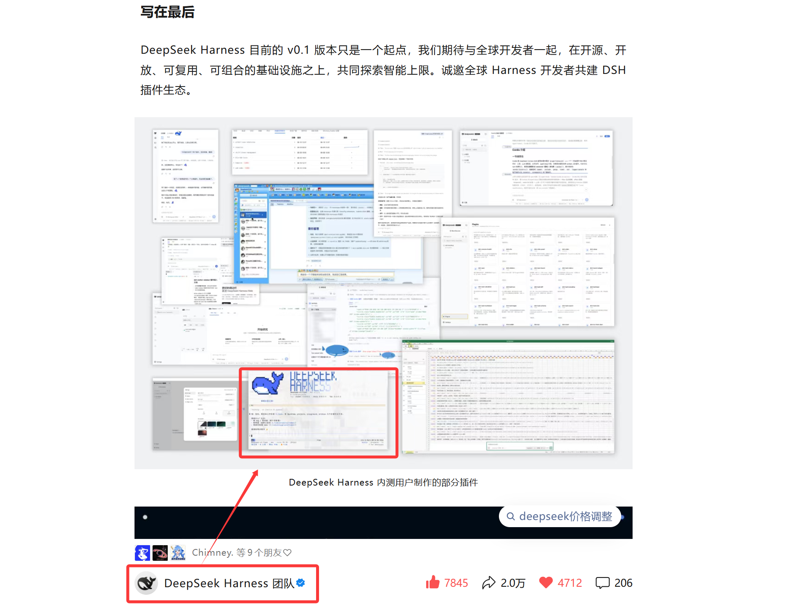

<p align="center">
  
</p>

<p align="center">
  <strong>English</strong> | <a href="README_ZH.md">简体中文</a>
</p>

<p align="center">
  <a href="https://www.npmjs.com/package/@deepseek-harness-tui/dsh-tui"></a>
  <a href="https://github.com/ccch1mneyyy/dsh-TUI/actions/workflows/ci.yml"></a>
  <a href="LICENSE"></a>
  
  <a href="https://github.com/ccch1mneyyy/dsh-TUI/stargazers"></a>
  <a href="https://www.npmjs.com/package/@deepseek-harness-tui/dsh-tui"></a>
</p>

# dsh-TUI

> An interactive terminal UI for DeepSeek Harness. It ships a pixel-whale
> header, live work status, streaming thinking, double-Esc time rewind, a
> context progress bar, and a TPS gauge. Zero core changes: it consumes only
> DSH's public exports, and is moving from a mounted plugin to an app with its
> own entry and composition root, where DSH loads in process as the first-party
> backend. Install to enable; uninstall leaves no patches behind.

## Highlights

- **Pixel whale pet** — three startup intros, click to wake; freezes after the first task.
- **Launchpad and first-run guide** — every ordinary launch lands on a landing page with a **real input box** (big text + whale + quick actions, dropping whole blocks on short/narrow terminals; whale-girl images use a compact native-canvas footprint instead of leaving a large gap before the title; on by default — /settings `launchpad` off boots straight into chat); command completion matches chat: `Tab` fills the input, `Enter` runs the command and clears it. The first run walks a four-step wizard (API key / language+theme / model+workspace / shortcuts), re-runnable with `/setup`.
- **Terminal-native UI** — streaming Markdown, tool cards, `/` and `@` completion, `#L12-14` ranges, history search, zh/en UI.
- **Task completion notifications** — DSH, Claude and Codex notify after successful live work settles, with no queued follow-up or active goal. The title is “dsh-TUI · Task complete”; the body shows the latest settled reply as a single-line plain-text preview (Markdown formatting removed, up to 200 characters). OSC 777/9 apply an additional 2048-byte sequence budget, including title and protocol bytes, preserving whole graphemes. No reply shows only the title; BEL only rings. `/settings` → Conversation: `taskNotifications` = `unfocused` (default), `always`, or `off`; `notificationMethod` = `auto` (default), `osc9`, or `bel`. Auto uses separate title/body fields on Ghostty/WezTerm (OSC 777) and Kitty (OSC 99); iTerm2/Warp and explicit `osc9` use a title prefix; other terminals ring the bell; delivery follows your terminal's notification/bell settings. tmux requires `set -g allow-passthrough on` for OSC notifications and `set -g focus-events on` for focus reporting. Terminals without focus reporting need `always`. Replay, cancellation and failures do not notify. Works in inline and fullscreen modes.
- **Native cursor** — focused text inputs inherit your terminal's cursor shape, color, blinking, and enabled animation or trail effects in both inline and fullscreen modes. The `/model` picker shows the same cursor during movement between provider tabs, model rows, and effort levels, then hides it after **0.5 seconds at rest**; clipped regions fall back to the model row. The session manager also moves this cursor between the workspace rail, session rows, and search box; typing claims the search caret, and navigation returns it to the focused row. Configure animation and trail effects in your terminal.
- **Images** — Kitty/Sixel thumbnails, centered preview with zoom and pan, paste-time fitting, text fallback. Kitty images scale to the reserved cells' physical pixels, including on HiDPI terminals.
- **Mermaid diagrams** — ````mermaid ```` fences drawn as Unicode diagrams.
- **LaTeX math** — `$…$` and `$$…$$` formulas as Unicode text, fractions and limits stacked in display blocks; `mathRendering: image` typesets block and one-row inline formulas as terminal images on graphics terminals.
- **Timeline rail** — every turn clickable; timeline / scrollbar / hidden gutter.
- **Side panel** — `Ctrl+B` splits the chat with a panel column once the terminal is wide enough; drag the divider to resize it. All eight built-in panels are enabled by default. The header shows each inactive panel's symbol; hover to see its name. Narrow terminals and inline mode keep full-screen panels.
- **Live state** — activity animation, context bar, TPS, cache hit rate, effort, tokens, session cost estimate (main + subagents), Git and session metadata.
  Context-bar fill follows backend occupancy; colors estimate content composition. Compaction clears obsolete estimates, and missing composition displays a single used block with a measured used count in both hover details.
- **One session manager** — `/resume` `/home` `/agentview` `/bg` `⌸`.
- **Session workflow** — `/new` `/compact` `/export` `/btw`, model hot-switch, fork, rewind, vim, fullscreen draft editor.
- **IDE selection channel** — a VS Code selection lands in the prompt.
- **DSH integrations** — presets, skills, MCP, goals, todos, subagents, questionnaires.
- **Account sign-in** — the standard profile offers pi-ai OAuth for ChatGPT/Codex, Claude, and Grok (plus OpenAI direct and Meta Muse when available), and Host-owned DeepSeek browser sign-in as `deepseek-account` on DSH 0.2.0-rc.1+. Use `/provider` or `/auth` without another plugin.
  A profile-only update from a global TUI patch that already mounts `dsh-tui-auth` can still start the official loopback callback listener on demand; fixed-port SSH forwarding still requires the global package to be aligned.
- **Extensions** — browser interaction, computer use and more.
- **Built for long sessions** — event-driven projection, virtualization, bounded caches.

Keys and commands: [Interaction and commands](docs/interaction.en.md). Everything else: [documentation index](docs/README.md).

## Preview

<div align="center">
  <picture>
    <source media="(max-width: 640px)" srcset="docs/assets/readme/preview-en-mobile.svg">
    
  </picture>
</div>

## Featured & Listed

Among the community plugins recommended by the **official lead of DeepSeek
Harness**, dsh-TUI is the first.

Featured by the **DeepSeek Harness official WeChat account**, listed in the
[dshfind](https://dshfind.com/en/plugins/ccch1mneyyy/dsh-TUI) plugin
directory, and ranked **#7 on [GitHub Trending](https://trendshift.io/repositories/146168)
daily** (TypeScript).

<div align="center">
  <table>
    <tr>
      <td align="center" valign="middle" width="50%">
        
        <br>
        <strong>Featured by the official WeChat account</strong>
      </td>
      <td align="center" valign="middle" width="50%">
        <a href="https://dshfind.com/en/plugins/ccch1mneyyy/dsh-TUI"></a>
        <br>
        <strong>Listed in the dshfind directory</strong>
        <br><br>
        <a href="https://trendshift.io/repositories/146168" title="GitHub Trending Daily #7 · TypeScript"></a>
        <br>
        <strong>GitHub Trending Daily #7</strong>
      </td>
    </tr>
  </table>
</div>

## Quick Start

Prerequisites: [Node.js](https://nodejs.org/en) and
[deepseek-harness](https://github.com/deepseek-ai/deepseek-harness).
The `deepseek-official` API-key route needs `DEEPSEEK_API_KEY`. On DSH
0.2.0-rc.1+, the standard profile can instead use `/auth login deepseek-account`
and select the separate account route through `/model`. Other supported
accounts can sign in through `/provider` or `/auth` after startup.

The primary compatibility target is DSH `0.2.1-rc.2`. This adapter supports its
Shell API, V4 session messages, declarative presets, and profile-backed settings;
older supported hosts retain their compatibility paths. See [configuration](docs/configuration.en.md).

On DSH rc.2, `/settings` also selects DeepSeek Search / Fetch APIs and edits their
endpoint and result limits, supporting custom Loader entry IDs and a masked API
key input saved through DSH's credential store. Official Flash model labels show the `1017` release
marker while retaining the `deepseek-flash` model ID.

On DSH 0.1.7, `/settings` uses the TUI's actual Loader entry ID, including custom
IDs. It requires matching profile dependencies with `@deepseek-ai/schemastery`
3.18.3 or newer; an incompatible schema stops TUI startup with repair guidance
instead of showing an uneditable settings page. Older hosts keep their legacy settings scope.

The `dsh-tui` section of `/settings` is saved in `~/.dsh-tui/settings.json`, shared by
every kernel; the first launch imports it once from the profile's `cordis.patch.yml` (and an older host's `~/.dsh/settings.yaml`)
(see [configuration](docs/configuration.en.md#tui-configuration)).

```sh
# Install the CLI and this plugin globally (ships the dsh-tui command)
npm install -g @deepseek-ai/dsh @deepseek-harness-tui/dsh-tui

# Start (first run auto-initializes the profile; needs pnpm)
dsh-tui
# Both `dsh-tui` and the short `dst` alias start the same TUI.
dst
```

Manual alternative: `dsh plugin --profile dsh-tui add @deepseek-harness-tui/dsh-tui`.
The repo's `sh install.sh` runs that step and checks the required commands.
Afterwards `dsh-tui` and `dsh --profile dsh-tui` are equivalent.

> **New-user note**: pnpm ≥11 blocks dependencies with install scripts by
> default and reports `ERR_PNPM_IGNORED_BUILDS`. Updates skip foreign-platform
> natives — the `@img/sharp-*` packages and the Claude SDK's per-platform
> bundles — so only this machine's binaries are fetched. `/update` and
> `dsh-tui update` write both settings automatically. An update never installs
> the Claude SDK on its own: it enters a profile only when you pick that
> backend in the kernel picker, which then installs the pinned SDK for the
> running platform. No manual step needed. Details:
> [Getting started](docs/getting-started.en.md#pnpm-install-script-blocks-and-foreign-platform-natives).

After startup the TUI checks for newer versions in the background. It never
blocks the first frame. Type `/update` for a one-shot upgrade. It restarts
automatically and resumes the current session. See
[Getting started](docs/getting-started.en.md) for the profile lifecycle,
source builds, and troubleshooting, including migration from the former
`dsh-cc-tui` package.

### CLI

| Command | Purpose |
| --- | --- |
| `dsh-tui` / `dst` | Start the TUI; `dst` is a short alias for the same program |
| `dsh-tui --resume [id]` · `dsh-tui update` · `dsh-tui doctor` | Resume a session · update the profile and align the launcher · pre-flight environment checks |
| `dsh-tui safe` | Read-only diagnostics, plugin inventory and repair guidance; `safe --rescue` builds a clean rescue profile |
| `dsh-tui version` · `dsh-tui help` | Launcher and profile versions and usage; both work even without a `dsh` install |

Leading DSH options such as `--dump-config` and `--patch <path>` are forwarded
unchanged; other arguments go to the app in `dsh --profile dsh-tui`. Use
`dsh-tui -- --resume=sid-1 ./notes` to send `--resume=sid-1 ./notes` as literal
prompt text, without selecting a session or workspace. When invoking DSH
directly, use `dsh --profile dsh-tui -- -- --resume=sid-1 ./notes`: the first
`--` belongs to DSH, the second to the app. Host options can precede a literal
prompt: `dsh-tui --patch ./overlay.yml -- --resume=sid-1` applies the overlay
and sends `--resume=sid-1` as prompt text without resuming that session.
Safe mode: [Getting started](docs/getting-started.en.md).

### Importing conversations from other agents (`dsh-tui migrate`)

Bring Claude Code, Codex, OMP, zcode, or Grok Build conversation histories into the DSH session store, then browse and resume them by their original working directory via `/resume`:

```sh
dsh-tui migrate                # list importable counts per agent (writes nothing)
dsh-tui migrate claude-code    # import every Claude Code conversation (likewise codex / omp / zcode / grok-build)
dsh-tui migrate codex --dry-run  # preview what would land, write nothing
```

- **Read-only source**: migration only reads the foreign agent's local store; artifacts are written through the official `JsonlSessionPersistence` backend, so imported sessions are first-class (openable, continuable).
- **Idempotent**: one deterministic UUID per source conversation — re-importing skips what is already present instead of stacking duplicates.
- **Structure preserved**: user/assistant messages, reasoning traces, tool calls with their results, and the source's context compactions (as native compaction checkpoints) are rebuilt turn by turn; harness-injected machine text opens no turn. An imported session can pick the work straight up.
In-TUI browsing: the session screen (`/resume`) shows a tab per agent that has conversations; picking one imports just that conversation and opens it.
In-TUI: `/migrate` (optionally `/migrate <agent> [--dry-run]`) runs the same import in a child process and reports through the notification flow.
CLI alternative: `dsh-tui migrate ...` from any shell runs the same import.
Full guide: [Session migration](docs/migrate.en.md).

- More agents (pi, opencode, …) extend the adapter registry as adapters land; grok-build reads `GROK_HOME` when set.

**VS Code**: use the integrated terminal or the `dsh-tui-vscode` extension. See [VS Code guide](docs/vscode.en.md). **Herdr**: run `dsh-tui` in a [Herdr](https://herdr.dev) pane; `idle` / `working` / `blocked` are reported through its local integration API.

Bare `--resume` (`-c`, `--continue`) reopens the last session of the backend this
launch selected. Startup recovery only ever targets that backend: a backend with no
last session, or a derived target that belongs to a different backend than the one
that actually booted (an unknown backend id falling back to DSH, `--backend` naming
a backend that is not installed, a remembered kernel that is not the marker's
source), refuses with a clear error and exit code 1 — never a silent cold start,
never another backend's session, never a new session. An explicit `--resume <id>`
passes that id to the selected backend as-is. The one exception is safe mode's
"retry normal startup": it retries the kernel and session recorded in
`last-run.json`, so a record whose backend is gone degrades to a warning plus a cold
start — that retry is the last way back.

### Experimental: Claude backend

dsh-TUI can also run its session on Claude: the same interface, driving the
Claude Code CLI through the Claude Agent SDK. Your project's `CLAUDE.md`,
settings, hooks, MCP servers and plugins load as the CLI loads them.

```sh
# once, in the dsh-tui profile directory (the SDK is an optional dependency)
cd ~/.dsh/profiles/dsh-tui && pnpm add @anthropic-ai/claude-agent-sdk@0.3.287
dsh-tui --backend claude     # or pick Claude in /kernel; that choice is remembered
```

The easiest install: open the kernel picker (the launchpad "Kernel" entry or
`/kernel`) and press Enter on the dim Claude row — the wizard locates the
profile directory and installs the pinned SDK for you; the command above is
its manual equivalent.
The confirmation shows the exact package and version. Closing the wizard,
including clicking outside it on the launchpad, cancels a pending installation.

- **Sign-in**: a `/channel` relay profile, your dsh-auth `anthropic` sign-in
  (`/login`), `ANTHROPIC_API_KEY` or cloud-provider variables, or an existing
  `claude login`, in that order. A `claude` on `PATH` is used when present, then
  one in the native install directory under your home (`~/.local/bin`, or
  `%USERPROFILE%\.local\bin` on Windows); every candidate has to launch and
  report a version, and the SDK's bundled binary is used only when none does.
- **Works**: streaming, tool cards, approvals and questions, `/model`,
  `/effort`, Claude's permission modes (`/permission`, `Shift+Tab`),
  `/compact`, `/context`, `/mcp`, `/resume`, `/fork`, double-`Esc` rewind,
  subagents, background jobs, images, `/btw`, and the USD cost Claude reports.
- **Not available**: DSH-only commands such as `/tree`, `/preset`,
  `/provider`, `/workspace`, `/agentview` and `/bg`. One process runs one
  backend; `/kernel` switches by restarting into a new session.
- **Startup**: the screen appears before the session opens, with only a light
  profile composed (this package plus the profile's third-party plugins); see
  [Claude backend](docs/claude-backend.en.md#known-limitations). The DSH kernel
  starts from the same entry and loads DSH in the same process behind its first
  screen; `DSH_TUI_HOST_ENTRY=0` restores the old launch path for every kernel.

Details and known limitations: [Claude backend](docs/claude-backend.en.md).

### Experimental: native Codex backend

Run your own Codex through `codex app-server`, sharing its configuration,
login, instructions, skills, hooks, MCP and native threads:

```sh
npm install -g @openai/codex@0.160.1
dsh-tui --backend codex
dsh-tui --backend codex --resume <thread-id>
```

Protocol baseline **0.160.1**, minimum **0.144.0**; other versions may show
drift. `CODEX_EXECUTABLE` selects a binary; `/kernel` remembers the backend.
`codex resume <id>` can open the same thread after the other writer exits.
This is not `migrate codex`, which imports history into DSH.
With native credentials, a writer conflict for an idle thread retained by the
official background server triggers a reconnection to that server. Managed
subscription credentials and `/channel` connections use private app-server processes.

Streaming/tool cards, approvals, questions, steer/queue/interrupt, model and
effort controls, Plan, `/review`, `/diff`, `/usage`, `/init`, skills and MCP
share the existing UI. Async questions open the questionnaire while Codex
continues working; answers steer the turn (or queue if unavailable), and
dismissing the question leaves work running. **Shift+Tab only toggles Plan**, keeping its underlying
permission preset; Full Access requires an explicit choice. Existing Codex
settings are respected, not overwritten with defaults. `/login` offers
ChatGPT OAuth, a device code or an API key (the last writes to Codex’s own
credential store). Relay `/channel` connections take precedence; managed
subscription tokens are only injected on first-party routes. dsh-TUI does
not write `~/.codex/config.toml` or log out your native Codex account. A
provider `env_key` from your own config (e.g. `DEEPSEEK_API_KEY`) that the
shell did not export is injected from the DSH credential store when the ref
is stored there — the active store first, then the default `~/.dsh` one — so
keep the key in the store, no per-shell export needed. When nothing can
supply it, the session still starts and the reason is reported once as a
start notice: Codex itself rejects every turn of that provider.

TPS includes hidden reasoning time and excludes tool execution time. Live
text estimates are corrected when Codex reports output token usage.

Native browsing/archive, fork/conversation rewind (the first message requires
Codex app-server 0.160.1+), paged history, images,
subagents, polled background terminals, goals and `/btw`/`/recap` use the
existing surfaces. `/logout` removes only the matching dsh-auth credential;
already-loaded managed tokens require a normal restart, not native logout.
The real 0.160.1 app-server passed nine credential-free offline checks and eight
daemon-resume checks, with no model turn or charge; real subscription login, credentialed model calls
and real-TTY interaction were not run. Only Codex identification/title
changes automatically, not palette or companion.
Using ChatGPT subscription tokens in third-party clients is subject to
OpenAI’s terms. Full instructions and current boundaries:
[Codex backend](docs/codex-backend.en.md).

### Experimental: DSH Agent Teams

DSH's experimental Agent Teams lets the session's agent (the Lead) create
named teammates that share the working directory, message each other and
coordinate on a shared task board. It is off by default. Install the
upstream bundle into the TUI profile once:

```sh
dsh plugin --profile dsh-tui add @deepseek-ai/dsh-experimental-agent-team-profile@0.2.1-rc.2
```

Then switch it with `/team on` / `/team off` (`/team` alone reports the
bundle, the service and this session's teammates). The switch enables or
disables the bundle in the profile, so it persists across restarts, and on a
`dsh --profile` launch it applies at once — running sessions included: the
model is told which tools came and went. Turning it off while teammates run
asks first, and switching off stops them: the team service releases the
teammates still running as it unloads. Inside a teammate session the other
teammates' runs are not visible, so the question counts them as possibly
running. The team record stays in the session for the next `/team on`.
`/plugin enable|disable` on the bundle does the same.

Pin the version to exactly your installed DSH version (the command above
uses the primary line `0.2.1-rc.2`; on DSH `0.2.1-alpha.5`, `0.2.0-rc.1` or
`0.2.0-rc.2` install `…-profile@` that same version). The team packages ship in lockstep with DSH and pin
their DSH peers exactly, so neither the untagged install nor `next` works.
When the package is missing, `/team on` prints the command with your
DSH version filled in on those lines (`0.2.1-rc.2` when the version cannot
be read); on any other DSH version it asks you to switch DSH to one of those lines first, since
no team bundle installs there.

While a request carries `spawn_teammate`, dsh-TUI drops `subagent` /
`subagent_fork` from it, and the team's `send_message` / `list_agents` /
`interrupt_agent` / `wait_agent` take the place of the legacy controls of the
same names, so `spawn_teammate` is the delegation tool; with the team off
the legacy tools are back. Subagents that are not team members (workflow,
ralph) keep `subagent`. A teammate shows up as a subagent row, a message between
members as a `✉ <sender>` bubble in the receiving session (a teammate's
received messages show on its subagent detail as agent messages), and the
other team tools as one-line cards (`send_message` with its target and
`sent`). The agents dashboard (Ctrl+A) and the agents side
panel switch to a team view: each teammate under its member name with
`running` / `idle` / `provisioning` / `failed` (a teammate whose turn ended
is idle — a message wakes it — not done), the Lead line, the remaining
subagents, a read-only task board (status, owner, `blocked`, write-scope
warnings) and a banner when the team record was rejected.

Limits: the switch covers the whole profile, not one session (a launch
without the profile plugin service, or without hot reload, needs `dsh plugin`
and a restart); there is no "enter teammate session" yet, and `/export` leaves team messages out. Upstream limits apply: teammates share one working directory, a
team lives in one process, and a task owner is never released automatically.

## Keybindings & Mouse

`Enter` send · `Tab` complete · `Ctrl+Enter` interrupt and send · `Alt+Up` recall the last message · `Esc` dismiss, double-`Esc` rewinds · `Ctrl+B` side panel · `Ctrl+O` details · `Ctrl+R` history (`↑`/`↓` and `Ctrl+R` are scoped to the current project) · `Ctrl+V` paste · `Ctrl+Shift+E` fullscreen draft editor · `?` shortcuts · `←` open the session manager (DSH backgrounds the current session first).

Text, cursor position and staged image attachments on the launchpad or in chat while the backend starts are preserved when the session becomes ready. Press `Enter` after it is ready to send; an earlier `Enter` preserves the draft without queuing it. Opening a new session while startup is pending clears the previous draft and its images.

The goal bar stays on one summary line: hovering truncated goal text in fullscreen or split shows the whole objective, and a bare `/goal` prints the full status — objective, phase, rounds or budget, available commands — as a transcript block in the `/plugins` shape. Inline mode sees no pointer events, so that block is how its users read a long objective.

While the model is working: `Enter` steers, `Tab` queues a follow-up, `Ctrl+Enter` interrupts and sends. Input that names a command is still a command — with or without arguments — so `/model` or `/new` reach their own gate (and the `/` overlay sinks the commands that affect the running conversation) instead of silently becoming an interruption; only text that is not a command — and a direct skill gesture such as `/skill-name …` — steers.

On native Windows, fragmented Win32 input records are reassembled across short input delays instead of appearing as numeric protocol text. The platform check only reports that this machine might run the private mode (win32-input-mode); a bare `ESC[` fragment is held only after one record has actually been decoded, while a fragment whose own shape is already record-specific holds on its own (which is how even the first record can survive a split). Windows terminals that never enter the mode (mintty, GitBash) therefore keep the classic VT path: a lone `Esc` keeps its normal response time, and a letter typed after a timed-out `ESC[` is not swallowed.

Incomplete records are held for a bounded recovery window (1 second from first capture, never extended by later input; 64 bytes max); past either bound the hold ends and input is handled as before. Unrecognized complete CSI sequences are not inserted as text; after a damaged CSI prefix, a bare ASCII letter can be consumed as its terminator, while normal Win32 key records and bracketed-paste text retain their own boundaries.

A session's very first record can still leave residue if it is split before its record-specific shape forms; once any record has been decoded, every split position is covered. Inside the recovery window, literal input starting with `[digit;…` cannot be told apart from a protocol prefix — it may be held, or re-joined to a preceding `Esc`. To type it, wait for the window to close, or avoid that shape right after `Esc`.

Terminal replies that arrive split are reassembled the same way (native Windows ConPTY is the common source): while the app still has a query awaiting its answer, an unfinished DA1 / DA2 / DSR / DECRPM / XTVERSION tail — even one split again after the introducer `Esc` was flushed — is held across input delays, but only while its shape can still complete into the response type that query expects. It is then consumed as the reply it completes instead of entering the prompt as protocol text.

That claim is evidence-gated, and this is the difference from earlier builds: no query awaiting an answer means nothing is claimed, so a literal `[?61;4c` typed right after `Esc` still enters the prompt exactly as before.

The window is bounded like the record hold (about a second, never extended by later input; 64 bytes max); past either bound it ends, and bytes still shaped like an unfinished reply prefix are dropped rather than shown.

Inside that window, with a query of the matching response type outstanding, same-shaped literal input can still be claimed as a reply; to type it, wait for the window to close (about a second), or avoid that shape while a query is outstanding.

Fragmented SGR mouse reports no longer land in the prompt as text: an incomplete report header is held until the rest arrives, and a report that completes is handled as a mouse event. The hold is armed only while mouse reporting is actually active (fullscreen, with mouse tracking enabled); inline sessions and terminals that never enable tracking keep the existing behavior. The claim window is bounded from first capture (at most 1 second; 64 bytes max), and a continuation arriving inside it is still claimed rather than replayed. Release has no timer: once a parse call sees either bound exceeded, it replays the held bytes as ordinary keys in arrival order — literal input can be delayed, but is never dropped.

Mouse (fullscreen): drag to select and copy, double/triple click to select a word or line, click tool cards, timeline ticks and `[Image #N]` previews.

Automatic copies keep the text selected; press `Esc` to clear it or start a new selection to replace it. Selection highlighting skips trailing padding and blank rows while preserving spaces within text and code indentation. Inline mode uses the terminal's native selection.

During a fullscreen text drag, the native cursor follows the selected text's edge using your terminal's enabled cursor animation or trail effects. Moving into trailing padding or blank rows keeps it at the nearest selected text edge. Releasing or cancelling the drag restores the focused input's caret.

File paths in prose can open the file-action menu; automatic detection does not extract a path from inside a slash-delimited token such as `working/idle/needs-input` or a date such as `2024/01/15`.

**Pasting**: the launchpad accepts clipboard images and pasted image paths as `[Image #N]` attachments; `Enter` sends them with the first message. Commands that do not accept images preserve the draft and its attachments. Image chips behave like chat: arrows step across them, Backspace at the end or Delete at the start removes the whole image, and Ctrl+W never splits a chip. Text pasted on the launchpad is folded to one line. In chat, native and bracketed paste keeps ordinary text and newlines, and never submits itself on arrival. On Windows terminals that deliver a paste as win32-input-mode key records, a record stream leaked into the payload is decoded back into the characters its `Uc` field encodes — newlines included — so the composer's line count matches what was pasted; only records with no character meaning are stripped (a multi-line paste no longer leaves stray `_`), and a complete record is always consumed before an ESC-less tail, so no payload character is deleted along with an orphan escape. Pasted CRLF collapses to a single newline; genuine underscores and bracketed-paste text are untouched.

**Dropped files**: a native Windows desktop drop (Windows Terminal / OpenConsole) arrives as an OSC 8 hyperlink; the parser restores its `file://` URI to a decoded local path before paste hygiene runs, so the `]8;id=…;` parameter bytes never reach the draft. Image paths enter the existing image staging pipeline; other files are inserted as a referenceable path (a path containing whitespace arrives in the composer's quoted `"…"` single-token form). Only `file://` URIs are restored, and it is fail-closed: a remote authority/UNC, a payload carrying several distinct URIs, or a URI that carries several tokens is refused and stays literal text rather than guessed.

Full reference: [Interaction and commands](docs/interaction.en.md).

## Built-in Commands

`/resume` · `/home` · `/agentview` · `/bg` · `⌸` open the same session manager: workspace rail, live state, filter, ★ pins. Also `/model` `/new` `/compact` `/export` `/btw` `/tree` `/fork` `/rewind` `/settings` `/setup` `/status` `/cost` `/jobs` `/skills` `/mcp` `/provider` `/auth` `/login` `/update`.

`/dsh`, `/codex`, and `/claude` switch directly to the named kernel, just like choosing it in `/kernel`: the choice is remembered and the process restarts into a new session. A running turn blocks switching; choosing the current kernel keeps the session. Availability checks and the Claude install wizard follow the same picker flow.

`/model` shows models and reasoning effort on one page. DSH has provider tabs with **Recently used** first, moving the current model to the top; `Tab` / `Shift+Tab` select the next / previous provider. Codex and Claude open their model catalogs directly, without provider or recents tabs. `↑/↓` select a model, `←/→` adjust its effort, `Enter` applies the model and any explicit effort draft, and `Esc` cancels. Changing only the model preserves the backend's preference handling. Mouse users can click the available tabs, models, effort levels, and select/cancel hints; clicking an effort level immediately applies the focused model and that effort and closes the picker. The wheel moves through models.

Short terminals keep the focused model and select/cancel actions visible, hiding descriptions and neighboring models first, then the effort row when only two rows remain.
Shortcuts sit below the title and effort levels have their own section; DSH, Claude, and Codex use the terminal background while covering the text underneath.

In `/provider`'s model list, focus a model and press `Tab` to edit its context window, max output tokens, reasoning efforts, and image input capability.

The session manager focuses the most recently used session in the current workspace; if there is no history, it focuses the new-session card. Moving between the workspace rail and session list preserves the selected session, including when the mouse enters the list. Switching to another workspace selects its latest session; switching back also starts from its latest session instead of restoring an earlier selection. Press `←` to move to the workspace rail. DST preloads the session list in the background after startup and updates the cache on success. The manager paints the last successful list immediately. Opening `/resume` while that read is pending shares the request and receives results that have already arrived. This first-paint snapshot survives restarts on DSH, Claude and Codex and is isolated by backend and storage directory. With or without a snapshot, all three backends prioritize the current workspace before filling in other workspaces. Fresh sessions and titles merge into the list immediately; cached rows from other workspaces remain until the full read finishes. Background updates preserve a session the user has selected manually. Claude and Codex first request up to 32 recent sessions within their native cwd scope: Claude's SDK includes Git worktrees in the same repository, while Codex matches the session cwd exactly. Codex listings reuse the running connection and read the first 32 regular results alongside the state DB shortcut, then fill in later pages. The browser groups sessions by their own cwd. DSH resolves the current workspace's metadata first and publishes it before reading other workspaces' logs, even when it has fewer than 32 sessions. Titles that require a deeper DSH log scan appear first with a fallback name and update in place when recovery finishes.
With DSH's current JSONL backend, startup and `/new` keep initial permission events in memory until further session activity saves the complete log. Flushing a session that holds only initialization leaves it unstored. Restarting an unstored empty session starts fresh.
Removing a workspace registration keeps its sessions accessible under a "History only" directory in the rail.
History-only directories offer edit and new-session actions; rename and remove are available for registered workspaces.

**Background jobs**: card headers open the focused task panel. Click the card body or use `Ctrl+O` to toggle the command between its first statement and full script. Commands and output use separate colored edges with `❯` (`>` on Windows) and `≡` on their first rows; output always stays at the latest two visible rows. `/jobs` and the side panel keep the full output scrollable, while `e` toggles the focused command. Consecutive blank script lines collapse to one.

**Background sessions**: On the DSH backend, `/bg` or `←` on an empty prompt backgrounds the current session and opens the session manager; `Esc` returns to it. Background sessions run in this process and stop when the TUI exits. Logs survive. On Claude/Codex, those entries open the session manager without backgrounding the session.

Full commands: [Interaction and commands](docs/interaction.en.md).

## Configuration & Extensions

Agent presets, themes, MCP servers, environment variables: [Configuration](docs/configuration.en.md) · [Themes](docs/themes.en.md).

With the DeepSeek brand, Companion skins `deepy` and `whaleGirl` replace the maid portrait; choose `whale` and enable Maid portrait to use it. Claude uses its own artwork; Codex uses its own raster portrait or the maid character-art fallback. Both brands ignore these settings for splash artwork. See [Configuration](docs/configuration.en.md).

DSH profiles inherit official reporting defaults: DeepSeek API requests carry plugin package identities and incremental Session logs to the configured `baseURL`, including third-party gateways, while OpenTelemetry uploads a Session-log prefix only after explicit feedback. User overrides remain supported; see [reporting settings](docs/configuration.en.md#official-request-metadata-and-feedback-reporting).

## How It Works

```text
dsh profile → dsh-base → dsh-TUI Cordis patch → agent preset + DSH services
  → session/event → Channel projection → React components → Ink/Yoga renderer → terminal
```

The TUI handles interaction and presentation. The session log is the source of truth. DSH services own models, tools, and persistence. Long sessions render in O(visible window).

Runtime path, module boundaries, performance notes and persistence locations: [Architecture and limitations](docs/architecture.en.md).

## Known Limitations

- Injected plugin context has no standalone display; it counts into the context segments.
- `/model` changes the next request’s route in the same session; history and session ID are preserved. The last used route is recorded when the next request starts. DSH versions before `0.1.2-alpha.3` refuse switching and prompt an upgrade because their subagents inherit the original route.
- `Ctrl+V` needs platform clipboard tools; unsupported bitmap formats are rejected.
- A dropped file is restored from its OSC 8 `file://` URI alone: multi-file drops, non-Windows terminal drop encodings and terminator-less truncated frames are not covered, and the hyperlink's own display name is never used.
- A background session lives inside this process and stops when the TUI exits.
- `/thinking` is not persisted; the kernel `minimal` agent preset (极简模式, one persistent-shell tool) mounts no compaction and does not prune tool results — a long session can hit the context limit, oversized tool output stays in the context in full, and `/compact` plus the questionnaire are unavailable under it (Help and `/` completion mark the entry, and entering the preset says so once); that is a different thing from the `/settings → Minimal UI` (极简界面) display switch; `/update` needs a `dsh --profile` launch and is refused while a turn is running.
- The status-bar `≈¥` and `/cost` are session estimates that include subagent usage (priced per each agent's model × peak/idle × cache components); unofficial or unlisted models show tokens only and are marked unpriced. **The platform bill is authoritative.**
- Fragmented SGR mouse reports are covered at the mechanism level with controlled fixture comparisons; the reporter environments (macOS → SSH, WSL2 with `dsh web`) have not been re-tested.

Full list: [Architecture and limitations → Known limitations](docs/architecture.en.md#known-limitations).

## Development

CI uses Node 24 and pnpm 11. The package supports Node `^22.19 || >=24`.

```sh
pnpm install --frozen-lockfile
pnpm build
pnpm smoke
```

`lib/types/` is ignored generated output. `pnpm build` recompiles it from a
clean output directory and runs the build gates. **Git URL installs are not
supported.** The source manifest keeps `@dsh-std/*` as workspace deps and
`vendor/dsh-std` as a submodule. pnpm ≥11 also refuses git-hosted `prepare`
scripts by default. Install the registry package instead:
`dsh plugin --profile dsh-tui add @deepseek-harness-tui/dsh-tui`. Rendering,
questionnaire, or tool-card changes also need the matching regression scripts.

## Plugin Ecosystem

Plugin development: [admission & development guide](tui-profile/docs/plugin-admission-and-development.md) · [plugin-template](https://github.com/dsh-tui-ecosystem/plugin-template) · [dsh-tui-ecosystem](https://github.com/dsh-tui-ecosystem). Reference implementation: `dsh-working-activity`.

Exported plugin subcomponents are admitted using the nearest package manifest of their ESM entry, including import-only and conditional exports; they do not inherit an outer package's identity.

A backend plugin (the `tui.dsh/v1alpha1` `Backend` contribution family) is in the kernel picker after a restart: the boot scans the bundles the profile declares, admits and registers each package-root `dsh-plugin.json` declaration, and reads the implementation from the package's `backend` export — importing that module only when the backend is actually selected.
Each bundle may declare one backend, and its handler id must match the declaration. Entries awaiting authorization are neither probed nor loaded, including when explicitly requested at startup.

Seam grading and API notes: [Plugin development](docs/plugins.en.md). The organization maintains the listing only; it does not endorse community plugins.

Installing a plugin from inside the TUI: `/plugin install <package | path | git url>`. It goes through the host's profile plugin manager — a pre-install notice, a trust confirmation, cancellable progress, build-script approval and exact-version exemptions. Packages on the first-party feed this package ships (`tui-profile/feed/first-party.json`, pinned per release and decided offline) skip the trust confirmation, and only a spec that names that exact version qualifies: a bare name, a tag or a range is resolved again at install time, so it is confirmed with the person instead. What was confirmed is what gets installed — the run pins the exact `name@version` the inspection read — and a turn that is still running refuses the install (finish it, or `/new`, first). The same actions remain available from the CLI (`dsh plugin --profile dsh-tui …`).

A spec names one of three things:

```sh
/plugin install /path/to/repo
/plugin install https://github.com/exam/ple.git
/plugin install @scope/package@1.2.3
```

Typing `/plugin install ` lists these three shapes in the completion popup, and the same shapes follow the installed names on `/plugin info `. They are examples, never candidates: `Tab` leaves the draft exactly as it is, and `Enter` runs the line you typed — the subcommand's usage line while the spec is still empty, your own spec once it is not. No example can therefore be inserted or installed by accident, and a real path that merely starts like one is never swallowed.

During installation, `esc` attempts cancellation and keeps the pane open until the write settles; if cancellation is too late, it waits for the installation to finish. During exemption registration, it waits for the current write and stops subsequent grants and the retry. Exemptions already written remain.

Failed installs show up to six redacted log lines; lines larger than 16 KiB are omitted with a notice.

Managing what is installed: `/plugin remove <bundle>`, `/plugin enable <name | row id>` and `/plugin disable <name | row id>`. A bundle is a composition layer and a row is one patch entry, so the two are separate actions, and a bundle name is matched before any row identity. A module name shared by multiple rows requires a specific row ID. **Gate 2 refuses the three ways this app could switch itself off** — removing or disabling the bundle that provides it, the host layer `dsh-base`, or one of its own rows — and says which rule it broke, without calling the service at all; that holds whether or not hot reload is live, which is the path the host's own guard misses. `enable` is never refused by gate 2 (it is the repair action). Every enable and removal asks first; `disable` asks only about a host-layer row. The host does not attest installed package sources, so even an exact feed match requires confirmation before enabling.

These three actions have no cancellation — the service offers none — so `esc` only closes the pane while the write finishes and reports itself into the transcript. Enable and disable have no CLI verb either (the service writes them into the profile's own files), and a removal never deletes your own data: anything left under `~/.dsh-tui` is reported once and left for you to delete.

## Documentation

- **Start** — [Getting started](docs/getting-started.en.md) · [VS Code](docs/vscode.en.md)
- **Use** — [Keys and commands](docs/interaction.en.md) · [User guide](docs/user-guide.en.md) · [Themes](docs/themes.en.md)
- **Configure** — [Configuration](docs/configuration.en.md)
- **Internals** — [Architecture and limitations](docs/architecture.en.md) · [Session mounting](docs/session-mount-runtime.en.md)
- **Plugins** — [Admission and development](tui-profile/docs/plugin-admission-and-development.md) · [Seams](docs/plugins.en.md)
- **Contribute** — [Contributing](docs/contributing.en.md) · [Roadmap](docs/roadmap.en.md) · [Community](docs/community-management.en.md)

Everything, bilingual: [docs/README.md](docs/README.md).

## Community

- **Ecosystem organization**: [dsh-tui-ecosystem](https://github.com/dsh-tui-ecosystem)
  hosts community plugins, templates, and the curated list. Come ship a
  plugin, pitch an idea, or just hang out 🐋
- **Chat groups** (Chinese-language): usage questions, plugin ideas, and
  feature wishes are all welcome.
- **Code of conduct**: please read the
  [Contributor Covenant Code of Conduct](CODE_OF_CONDUCT.en.md) before taking
  part.

| WeChat group (dsh-TUI community 4) | QQ group (ID 572549239) |
| :---: | :---: |
|  |  |

> The WeChat QR code expires roughly every 7 days; if it stops working, use
> the QQ group (572549239) or open an issue to nudge us for a refresh.

## Permissions and Security Boundary

> **Windows security warning:** the Windows profile defaults to `danger-full-access` with approval set to `never`, so tools have unrestricted access. Inspect and tighten the profile before starting next to sensitive credentials or in an untrusted repository.

No sandbox of its own: dsh-TUI uses the active DSH profile's filesystem, shell, sandbox and approval policies. Permission presets come from the DSH `permissionPresets` registry.

**Permission persistence** (all three backends): the Claude and Codex backends keep their `/permission` picks in `~/.dsh-tui/backends/<id>/prefs.json`; the DSH pick is kept at `~/.dsh-tui/permission.json`. Every durable preset switch teaches it (picker, typed `/permission`, Shift+Tab static modes, or a switch the official command performed on its own), and a session that never customized its permission planes starts on the remembered preset — applied through the same official switch path. "Never customized" is about the user: the composition writes its own default preset into every fresh session at creation, and those events do not count. Plan-mode transients and the experimental Auto review preset (see below) are excluded, a `DSH_PERMISSION_MODE` launch pin (this run's initial permission plane) outranks the file, and an identity the mounted roster no longer offers is skipped.

**Auto review** (DSH, experimental): when the `dsh-experimental-auto-review` plugin is enabled, the `auto` preset (shown as "Auto review", tagged `EXP`) appears in `/permission` and its completions live, and disappears when the plugin is removed. It is session-only: the model reviews every tool call before it runs, there is no file sandbox, and each call costs one extra model request; its approval prompts show the localized reason, and a subagent denial reads "Auto review denied; not executed". Picking it in the picker first shows a risk confirmation (`Enter` enables, `Esc` goes back; in fullscreen its Enable / Go back rows are clickable); a typed `/permission auto` switches directly. Once the current session has selected it, the picker skips the confirmation and Shift+Tab stops skipping it.

**Upstream auto-retry** (DSH): whenever a session binds (boot, `/model` switch, resume), the TUI seeds a retry policy — 5 attempts, transport-drop-aware failure codes including `STREAM_CLOSED` (a dropped upstream stream) — on **the provider route that session actually uses**, through the official `llm-pi-ai` settings section (the policy the kernel's `llm-retry` plugin executes). Only routes without an explicit `retryPolicy` are seeded — dormant channels are never written — and `upstreamRetry: false` in cordis.yml opts out.

Details: [Permissions and security boundary](docs/architecture.en.md#permissions-and-security-boundary).

## Acknowledgments

- The pixel whale's 22 hand-drawn frames and its idle behaviors are ported
  from **[dsh-ui-whale](https://github.com/lhh010/dsh-ui-whale)**. The frames
  were drawn cell by cell in Excel. The idle behaviors are fin flutters, tail
  thumps, sleep Z's, and click hearts. dsh-ui-whale is the DeepSeek Harness
  web whale-pet plugin by [@lhh010](https://github.com/lhh010), BSD-3-Clause.
  Thank you for the art and the inspiration 🐋💜

## Friends' Links

Community, related projects, and companion tools built by friends:
[see the links page](docs/links.md)

## Stars

[](https://star-history.com/#ccch1mneyyy/dsh-TUI&Date)

---

## Maintainers

<table>
  <tbody>
    <tr>
      <td align="center" width="150"><a href="https://github.com/ccch1mneyyy"></a><br><a href="https://github.com/ccch1mneyyy"><b>ccch1mneyyy</b></a><br><sub>Core development &amp; maintenance</sub></td>
      <td align="center" width="150"><a href="https://github.com/CikeSeven"></a><br><a href="https://github.com/CikeSeven"><b>CikeSeven</b></a><br><sub>Performance &amp; stability</sub></td>
      <td align="center" width="150"><a href="https://github.com/T-Auto"></a><br><a href="https://github.com/T-Auto"><b>T-Auto</b></a><br><sub>Architecture &amp; ecosystem adaptation</sub></td>
      <td align="center" width="150"><a href="https://github.com/AdamPlatin123"></a><br><a href="https://github.com/AdamPlatin123"><b>AdamPlatin123</b></a><br><sub>Security &amp; interaction</sub></td>
      <td align="center" width="150"><a href="https://github.com/Nagi-ovo"></a><br><a href="https://github.com/Nagi-ovo"><b>Nagi-ovo</b></a><br><sub>Test infrastructure &amp; terminal rendering</sub></td>
    </tr>
  </tbody>
</table>

※ In no particular order

---

## Contributors

[](https://github.com/ccch1mneyyy/dsh-TUI)

## License

[MIT](LICENSE)
