<p align="center">
  
</p>
<p align="center">
  <a href="README.md">English</a> | <strong>简体中文</strong>
</p>

<p align="center">
  <a href="https://www.npmjs.com/package/@deepseek-harness-tui/dsh-tui"></a>
  <a href="https://github.com/ccch1mneyyy/dsh-TUI/actions/workflows/ci.yml"></a>
  <a href="LICENSE"></a>
  
  <a href="https://github.com/ccch1mneyyy/dsh-TUI/stargazers"></a>
  <a href="https://www.npmjs.com/package/@deepseek-harness-tui/dsh-tui"></a>
  
</p>

# dsh-TUI

> 面向 DeepSeek Harness 的交互式终端界面：像素鲸鱼顶栏、实时工作状态、流式思考展示、双击 Esc 时间回溯、上下文进度条与 TPS 仪表。
> 零核心改动，只消费 DSH 的公开导出；正从「挂载型插件」演进为拥有自身入口与组装根的终端应用，届时 DSH 作为首方后端在进程内加载。安装即启用，卸载不留核心补丁。
回合空闲后，已完成目标自动从输入框上方隐藏；Todo 侧栏仍保留历史。`Ctrl+Q` 在工作中折叠待办，在空闲时隐藏／恢复目标与待办底部面板；空闲时点击待办标题也可隐藏。隐藏只影响当前展示，新目标／待办快照或会话会重新显示；`/goal clear` 不会清空待办。

分栏 diff 对纯新增、纯删除文件使用完整正文宽度，不保留空的另一栏。普通修改仍双栏显示；多文件分别决定布局，判断先于折叠与流式展开。

窄面板中的压缩状态保持单行：先省略阶段与取消提示，再缩短标签；计时只会完整显示，不拆开数字。


## 功能亮点

没有可信 Component 身份的面板作为临时项：设置显示可读标题与本次运行的独立编号，勾选立即生效但不保存，无关设置修改会保留当前选择。旧 `actN:panel` 无法安全辨认来源，请移除占位项后重新选择当前面板。名称为 `actN` 的可信 Component 保留公开运行时地址；明确勾选时仅在持久偏好中使用 `component:actN:panel`，避免认领旧匿名项。

默认推理强度设置使用当前后端/模型声明的档位，包括自定义 ID。当前目录不支持的已存值仍显示并保留；目录加载中或不可用时仅可选自动。DSH 自动依次采用已存 `/effort`、配置默认值、模型默认。Claude/Codex 启动采用自动模式或恢复会话时保留后端偏好；在设置中主动选择自动会重置为模型默认。明确修改设置会作用于下一请求；不支持的偏好会提示回落，不会强行发送给当前路由。

通过 `@路径` 引用的图片与粘贴图片使用相同的准入、缩放和格式转换策略。调整提示采用实际保存的尺寸和格式；需要转换的动画会明确拒绝，避免静默丢帧。提及图片和暂存图片仍按原文顺序共享数量与实际保存字节额度。

恢复 DSH 会话时保留会话记录的推理强度，重新附着时保留其当前选择。保存的默认值用于新会话；用户明确执行 `/effort` 或修改默认推理强度设置，仍会作用于当前会话的下一请求。


- **像素鲸鱼娘** — 开屏三选一动画，点击唤醒；开始第一个任务后定格。
- **落地页与首次引导** — 每次普通启动先落在带**真输入框**的落地页（大字 + 鲸鱼 + 快捷入口，窄/矮终端自动整块降级；鲸娘图像按原生画布紧凑占位，避免图片与大字之间留出大块空白；默认开启，/settings 的 `launchpad` 关闭后直接进聊天页）；命令补全与聊天页一致：`Tab` 填入输入框，`Enter` 执行并清空。首次运行走四步向导（API Key / 语言主题 / 模型工作区 / 快捷键），`/setup` 随时重跑。
- **终端原生界面** — 流式 Markdown、工具卡、`/` 与 `@` 补全、`#L12-14` 行区间、历史搜索、中英界面。
- **原生光标** — 聚焦的文本输入框继承终端的光标形状、颜色、闪烁及已启用的动画或拖尾效果，inline 与 fullscreen 均支持。`/model` 选择器在提供商标签、模型行和推理档位之间移动时显示同样的光标，停稳 **0.5 秒后隐藏**；区域被裁剪时回落到模型行。会话管理界面也会在工作区栏、会话行与搜索框之间移动原生光标；输入时移到搜索框，导航时回到聚焦行。动画与拖尾效果在终端设置中配置。
- **图片** — Kitty/Sixel 缩略图，居中大图可缩放平移，粘贴前按限额适配，无图形时文字回退。Kitty 图片按预留格子的物理像素缩放，适配 HiDPI 终端。
- **Mermaid 图表** — ```` ```mermaid ```` 代码块画成 Unicode 字符图。
- **任务完成通知** — DSH、Claude、Codex 的实时任务成功结束，且没有排队的后续输入或活动目标时提醒。标题为「dsh-TUI · 任务已完成」，正文显示本轮最新回复的单行纯文本摘要（去掉 Markdown 样式，最多 200 字符）；OSC 777/9 还会按包含标题和协议开销的 2048 字节预算截短，保留完整字素；没有回复时只显示标题，BEL 只响铃。`/settings` → 对话：`taskNotifications` 可选 `unfocused`（默认，仅失焦）、`always`（每次完成）、`off`；`notificationMethod` 可选 `auto`（默认）、`osc9`、`bel`、`windows`。自动模式在 Ghostty/WezTerm（OSC 777）与 Kitty（OSC 99）分别显示标题与正文；iTerm2/Warp 与显式 `osc9` 将标题放在正文前；其他终端使用响铃，实际提醒取决于终端的通知/响铃设置。在本地 Windows 上，`auto` 解析为 `windows`，即系统原生通知：任务完成时弹出 toast；首次弹出会注册当前用户的 AppUserModelID（写 HKCU），弹出比任务结束晚约 3 秒（零安装路线要付的 PowerShell 冷启动代价）；DSH 会话所在运行中 profile 的外部 DSH 通知插件已启用且处于 active 时，dsh-TUI 让位（不弹也不响）；仅安装但已禁用的插件不会吞掉提醒；注册写不进去时回落到响铃，不会静默。SSH 会话的 `auto` 保留所连接终端的通知协议；显式 `windows` 仍选择运行主机的原生通知。tmux 的 OSC 通知需要 `set -g allow-passthrough on`，焦点报告需要 `set -g focus-events on`。不支持焦点报告的终端可选 `always`。回放、取消和失败不通知；inline 与 fullscreen 均支持。
- **LaTeX 公式** — `$…$` 与 `$$…$$` 公式转成 Unicode 文本，块级公式里的分数与上下限竖排；`mathRendering: image` 时在支持图形的终端里把块级公式与能压成一行的行内公式排成终端图片。
- **时间轴** — 全部回合可点；右栏时间线 / 滚动条 / 隐藏。
- **侧栏面板** — `Ctrl+B` 在聊天右侧展开面板列，拖拽分隔线即可调宽，默认启用全部 8 个内置面板，之后注册的插件面板也默认启用（`sidePanel.panels: '*'`；在 `/settings` 取消勾选会改成显式列表）；顶部以各面板符号显示未选中的页面，悬停显示名称。终端够宽才分栏，窄屏与 inline 模式保持整屏面板。`todo` 面板里长目标按面板宽度完整换行、状态单独一行；内容超出视口时，聚焦面板后用 `↑`/`↓` 或滚轮逐行滚动（全部待办也随滚动展开）（聊天页底部的紧凑目标行仍是单行省略 + 悬停全文）。
- **实时状态** — 工作动画、上下文条、TPS、缓存命中率、推理强度、token、本会话费用估算（主会话 + 子代理）、Git 与会话信息。标题、轨迹条和会话状态动画独立于正文更新，在空闲或失焦时暂停。
  上下文条的填充长度跟随后端占用量，颜色按内容构成估算；压缩后清理过期估算，缺少分类时显示单块已用区域，条和 ctx 字段的悬停明细都报实测已用量。
- **唯一的会话管理界面** — `/resume` `/home` `/agentview` `/bg` `⌸`。
- **会话工作流** — `/new` `/compact` `/export` `/btw`、模型热切换、fork、回溯、vim、全屏草稿编辑器。
  `/btw` 在侧栏无法显示时回退到浮层；主任务问卷与全屏草稿编辑器优先接管，侧问与草稿保持原样。
- **IDE 选区通道** — VS Code 里选中的代码进 prompt。
- **DSH 集成** — presets、技能、MCP、目标、待办、子代理、问卷。
- **账号登录** — 标准 profile 提供 pi-ai 的 ChatGPT/Codex、Claude、Grok OAuth（可用时还有 OpenAI 直连与 Meta Muse）；DSH 0.2.0-rc.1+ 还通过宿主服务提供 DeepSeek 浏览器登录，路由为 `deepseek-account`。通过 `/provider` 或 `/auth` 使用，无需另装插件。
  仅更新 profile 而留下已挂载 `dsh-tui-auth` 的旧全局 TUI 补丁时，本地登录也会按需启动官方 loopback 回调监听器；SSH 固定端口转发仍需对齐全局安装包。
- **扩展** — 浏览器交互、computer use 等。
- **为长会话设计** — 事件驱动投影、虚拟化、有界缓存。

键位与命令：[交互与命令](docs/interaction.md)。其余见[文档索引](docs/README.md)。

修改无关设置不会隐藏已注册的插件侧栏面板；编辑已启用面板列表仍会应用你的明确选择。


工作区侧栏与会话管理器按同一规则计数：包含当前会话，排除空日志、子代理、当前分支祖先及归档会话。已登记但无可见会话的工作区保留为零；加载与读取失败单独显示，按 `r` 刷新。

DSH 0.2.1 起，Agent 把会话切到别的目录（`working_directory` 工具或 Git worktree）后，状态栏、Git 分支、`@` 补全、`!` 命令、点击的路径、技能命令与已加载上下文都会跟随，`/resume` 后也一样；会话仍登记在启动时的项目下。移动前已渲染的卡片里的相对路径，在移动后点击时按会话当前目录解析；绝对路径不受影响。

全屏鼠标选区归属于手势起始栏，包括聊天、侧栏及左右 diff。对角拖选、选词与选行只复制该栏；各栏软换行独立拼接，保留原文换行；拖动分隔线只调整宽度。

## 界面预览

<div align="center">
  <picture>
    <source media="(max-width: 640px)" srcset="docs/assets/readme/preview-zh-mobile.svg">
    
  </picture>
</div>

## 官方收录

**DeepSeek Harness 官方负责人**推荐的社区插件中，dsh-TUI 是首个被推荐的插件。

本插件被 **DeepSeek Harness 官方公众号**推文收录，也被 [dshfind](https://dshfind.com/ccch1mneyyy/dsh-TUI) 插件目录收录，并登上 [GitHub Trending](https://trendshift.io/repositories/146168) 日榜第七（TypeScript 口径）。

<div align="center">
  <table>
    <tr>
      <td align="center" valign="middle" width="50%">
        
        <br>
        <strong>DeepSeek Harness 官方公众号推文收录</strong>
      </td>
      <td align="center" valign="middle" width="50%">
        <a href="https://dshfind.com/ccch1mneyyy/dsh-TUI"></a>
        <br>
        <strong>dshfind 插件目录收录</strong>
        <br><br>
        <a href="https://trendshift.io/repositories/146168" title="GitHub Trending 日榜 #7 · TypeScript 口径"></a>
         <br>
        <strong>GitHub Trending 日榜第七</strong>
      </td>
    </tr>
  </table>
</div>

## 快速开始

### Windows 一键安装（x64）

从 [Releases](https://github.com/ccch1mneyyy/dsh-TUI/releases) 下载 `dsh-tui-setup-win-x64.exe` 双击运行。免管理员、全离线，也无需预先装 Node 或 DSH。

### 命令行安装

前置条件：安装 [Node.js](https://nodejs.org/zh-cn) 与 [deepseek-harness](https://github.com/deepseek-ai/deepseek-harness)。`deepseek-official` API key 路由需要 `DEEPSEEK_API_KEY`；DSH 0.2.0-rc.1+ 的标准 profile 也可用 `/auth login deepseek-account` 登录，再通过 `/model` 选择独立的账号路由。其他支持的账号可在启动后通过 `/provider` 或 `/auth` 登录。

主适配目标为 DSH `0.2.1-rc.5`，已接入新版 Shell API、V4 会话消息、声明式预设与
profile 设置；旧受支持版本保留兼容路径。迁移说明见[配置参考](docs/configuration.md)。

DSH 0.2.1-rc.2 及之后还可在 `/settings` 选择 DeepSeek 搜索 / 抓取 API、修改端点与结果数。
分区支持自定义 Loader 行 ID，可直接输入 API key，密钥以掩码显示并保存到 DSH 凭据库。
官方 Flash 模型显示 `1017` 发布标记，模型 ID 仍为 `deepseek-flash`。

`/settings` 按页签组织：TUI 自己的设置位于「常规」页，插件声明的页单独成签
（`Tab` / `Shift+Tab` 或全屏下点击页签切换；只有一页时不显示页签）。

DSH 0.1.7 的 `/settings` 使用 TUI 实际的 Loader 行 ID，也支持自定义 ID。
profile 依赖须配套，包含 `@deepseek-ai/schemastery` 3.18.3 或更新版本；
Schema 不兼容时，TUI 在启动阶段报错并提示修复安装，不再显示不可编辑的设置页。
旧 host 继续使用原有设置 scope。

`/settings` 的 `dsh-tui` 分区保存在 `~/.dsh-tui/settings.json`，所有内核共用；第一次启动时
从 profile 的 `cordis.patch.yml`（以及旧版 host 的 `~/.dsh/settings.yaml`）一次性导入（见[配置参考](docs/configuration.md#tui-配置)）。

```sh
# 安装（全局，自带 dsh-tui 命令）
npm install -g @deepseek-ai/dsh @deepseek-harness-tui/dsh-tui

# 启动（首次运行自动初始化 profile，需要 pnpm）
dsh-tui
# dst 是短别名，启动同一个 TUI
dst
```

手动安装：跑仓库根目录的 `install.sh`，或 `dsh plugin --profile dsh-tui add @deepseek-harness-tui/dsh-tui`。之后 `dsh-tui` 与 `dsh --profile dsh-tui` 等价。

> **新用户提示**：pnpm ≥11 默认拦截带安装脚本的依赖，报 `ERR_PNPM_IGNORED_BUILDS`。更新时还会忽略异平台原生包（`@img/sharp-*` 与 Claude SDK 的 `@anthropic-ai/claude-agent-sdk-*`），只取本机平台的二进制。`/update` 与 `dsh-tui update` 都会自动写好这两份配置，无需手工处理。更新**从不**顺手安装 Claude SDK：只有你在内核选择器里选中该后端时才会装，且只装当前平台对应的版本。细节见[安装与快速开始](docs/getting-started.md#pnpm-安装脚本拦截与异平台原生包)。

TUI 启动后会在后台检查新版本，不阻塞首帧。有更新时输入 `/update` 一键升级，自动重启并恢复当前会话。profile 叠加机制、源码构建与常见问题见[安装与快速开始](docs/getting-started.md)。

### CLI 子命令

自动化入口：`dst -p "任务"`、`dst run --json`、`dst session list --json`。
独立引擎不加载 TUI，也不继承其 profile/偏好；执行与查询仍由官方 DSH
headless/服务拥有（当前验证 0.2.0-rc.2、0.2.1-rc.2、0.2.1-rc.3、0.2.1-rc.4 与 0.2.1-rc.5）。`dst cli --help` 查看全部命令，
`dst dsh <参数...>` 原样转交官方。协议、限制、会话恢复边界与
Node/Python/PowerShell 示例见[自动化 CLI](docs/cli.md)。

| 命令 | 作用 |
| --- | --- |
| `dsh-tui` / `dst` | 启动 TUI；短别名是同一个程序 |
| `dsh-tui --resume [id]` · `dsh-tui update` · `dsh-tui doctor` | 恢复会话 · 更新 profile 并对齐启动器 · 环境体检 |
| `dsh-tui safe` | 只读诊断、插件清单与修复指引；`safe --rescue` 创建干净的救援 profile |
| `dsh-tui version` · `dsh-tui help` | 启动器与 profile 版本、用法；没装 dsh 时这两条也能用 |

前置 DSH 选项（如 `--dump-config`、`--patch <路径>`）原样转发，
其余参数交给 `dsh --profile dsh-tui` 中的应用。使用
`dsh-tui -- --resume=sid-1 ./notes` 可将 `--resume=sid-1 ./notes` 作为字面提示词，
不选择恢复会话或工作区。直接调用 DSH 时，使用
`dsh --profile dsh-tui -- -- --resume=sid-1 ./notes`：第一个 `--` 属于 DSH，
第二个属于应用。宿主选项可以放在字面提示词之前：
`dsh-tui --patch ./overlay.yml -- --resume=sid-1` 会应用补丁，
并将 `--resume=sid-1` 作为提示词发送，而不恢复该会话。
安全模式：[安装与快速开始](docs/getting-started.md)。

### 迁移其他编程代理的对话（`dsh-tui migrate`）

把 Claude Code、Codex、OMP、zcode、Grok Build 的本地对话历史导入 DSH 会话库，之后用 `/resume` 按原工作目录浏览与恢复：

```sh
dsh-tui migrate                # 列出各代理可迁移的对话数量（不写入）
dsh-tui migrate claude-code    # 导入 Claude Code 的全部对话（codex / omp / zcode / grok-build 同理）
dsh-tui migrate codex --dry-run  # 只预览将落盘的内容，不写入
```

- **只读源**：迁移只读取源代理的本地存储，绝不修改；产物经官方 `JsonlSessionPersistence` 后端写入 `$DSH_HOME/sessions`——导入的会话是一等公民（可打开、可续聊）
- **幂等**：同一源对话命中同一确定性 UUID——重复导入跳过已存在项，不堆叠重复
- **保留结构**：按轮次还原用户/助手消息、思考过程（reasoning）、工具调用及其结果，以及源里的上下文压缩（写为原生压缩检查点）；harness 注入的机器文本不开轮。导入的会话可以直接接着做事
TUI 内浏览：会话管理界面（`/resume`）为每个有会话的代理显示一个标签，选中一条即只导入这一条并直接打开。
TUI 内：`/migrate`（或 `/migrate <agent> [--dry-run]`）以子进程运行同一导入，经通知流汇报，不卡界面。
CLI 形态：任意终端运行 `dsh-tui migrate ...`，与 TUI 内执行同一套导入。
完整指南：[会话迁移](docs/migrate.md)。

- pi / opencode 等其他代理经 adapter 注册表逐步扩展；grok-build 支持读 `GROK_HOME` 环境变量

**VS Code**：用集成终端，或用 `dsh-tui-vscode` 扩展。见 [VS Code 使用指南](docs/vscode.md)。**Herdr**：在 [Herdr](https://herdr.dev) 窗格运行 `dsh-tui`，经其本地集成 API 报告 `idle` / `working` / `blocked`。**任意终端**：dsh-tui 经 pty 用 [OSC 7501（Program Status Protocol）](https://www.superlogical.com/rex/docs/build/program-status) 报告 `idle` / `working` / `blocked` / `done` / `error`，实现了该协议的终端与 agent 收件箱可据此显示会话在做什么；未实现的终端会忽略该序列。设 `DSH_TUI_PROGRAM_STATUS=0` 可关闭。

裸 `--resume`（`-c`、`--continue`）恢复本次启动所选后端自己的上次会话。
启动恢复只针对所选后端：该后端没有上次会话，或派生出来的目标不属于最终启动的后端
（未知后端 id 回落 DSH、`--backend` 指向未安装的后端、未设 `--backend` 而跟着记忆的
内核走），一律明确报错并以退出码 1 收束——不静默冷启动、不恢复别的后端的会话、不新建
会话。显式 `--resume <id>` 则把该 id 原样交给选定后端。
唯一的例外是安全模式的「重试正常启动」：它按 `last-run.json` 记录的内核与会话重试，
记录里的内核已经不在时降级为告警 + 冷启动——那是用户最后的退路。

### 实验性：Claude 后端

dsh-TUI 也可以把会话跑在 Claude 上：界面不变，背后由 Claude Agent SDK 驱动
Claude Code CLI。项目的 `CLAUDE.md`、设置、hooks、MCP 服务器与插件按 CLI 的方式加载。

```sh
# 一次性：在 dsh-tui 的 profile 目录安装（SDK 是可选依赖）
cd ~/.dsh/profiles/dsh-tui && pnpm add @anthropic-ai/claude-agent-sdk@0.3.287
dsh-tui --backend claude     # 或在 /kernel 里选 Claude，选择会被记住
```

最省事的装法：在内核选择器（启动页「内核」或 `/kernel`）里对未安装的 Claude 行按
Enter，按引导一键安装——dsh-TUI 自己定位 profile 目录并装锁定版本的 SDK，上面的
命令是它的手动等价形式。
确认面板显示实际安装的包名与版本。关闭向导（包括在启动页点击向导外部）会取消在途安装。

- **登录**：依次使用 `/channel` 渠道档案、dsh-auth 的 `anthropic` 订阅登录（`/login`）、
  `ANTHROPIC_API_KEY` 或云厂商环境变量、本机已有的 `claude login`。`PATH` 上有
  `claude` 就用它，其次看用户主目录下的原生安装目录（`~/.local/bin`，Windows 是
  `%USERPROFILE%\.local\bin`）；每个候选都要能启动并报出版本，都没有时才用 SDK
  自带的二进制。
- **可用**：流式回复、工具卡、审批与问卷、`/model`、`/effort`、Claude 的权限模式
  （`/permission`、`Shift+Tab`）、`/compact`、`/context`、`/mcp`、`/resume`、`/fork`、
  双击 `Esc` 回退、子代理、后台任务、图片、`/btw`，以及 Claude 上报的美元费用。
- **不可用**：DSH 专属命令，如 `/tree`、`/preset`、`/provider`、`/workspace`、
  `/agentview`、`/bg`。一个进程只跑一个后端，`/kernel` 切换时会重启并开新会话。
- **启动**：界面先于会话出现，只组合轻量 profile（本包与 profile 声明的第三方插件），
  见 [Claude 后端](docs/claude-backend.md#已知限制)。DSH 内核从同一入口启动，界面先出现，
  DSH 在同一进程里加载；`DSH_TUI_HOST_ENTRY=0` 让所有内核恢复原来的启动方式。

详细说明与已知限制：[Claude 后端](docs/claude-backend.md)。

### 实验性：Codex 原生后端

通过 `codex app-server` 驱动你自己的 Codex，沿用配置、登录、指令、skills、hooks、
MCP 与原生 thread：

```sh
npm install -g @openai/codex@0.160.1
dsh-tui --backend codex
dsh-tui --backend codex --resume <thread-id>
```

协议基线 **0.160.1**，最低 **0.144.0**，其他版本可能提示 drift。`CODEX_EXECUTABLE`
指定二进制，`/kernel` 记住后端。退出另一写进程后，`codex resume <id>` 也能打开同一
thread；这不是把历史导入 DSH 的 `migrate codex`。
使用原生凭据时，若后台 Codex 服务保留了空闲会话的写入锁，恢复会自动重连该服务。
托管订阅凭据与 `/channel` 连接继续使用独立的 app-server 进程。

流式/工具卡、审批问卷、插话/排队/打断、模型与 effort、Plan、`/review`、`/diff`、
`/usage`、`/init`、skills 与 MCP 复用现有界面。异步提问会打开问卷，同时 Codex 继续
执行；答案插入当前回合（不可插话时排队），取消问卷保留运行。**Shift+Tab 只开关 Plan**，保留底层
权限档；Full Access 必须明确选择。已有 Codex 设置不会被默认值覆盖。`/login` 提供
ChatGPT OAuth、设备码或 API key（后者写入 Codex 自己的凭据存储）。`/channel` 连接
优先，托管订阅令牌只在第一方路由注入；不写 `~/.codex/config.toml`，不退出原生登录。
自己 config.toml 里 provider 声明的 `env_key`（如 `DEEPSEEK_API_KEY`）若未在 shell
导出、但 DSH 凭据库存有该 ref，会自动注入子进程——先查活动 home 的库，再回退默认
`~/.dsh` 的库，key 存进凭据库即可，无需每次导出。两边都拿不到时**不拦启动**：拒绝
发生在 Codex 自己的每个回合，dsh-TUI 只在启动时把原因报一次。

Claude 与 Codex 的 `/channel` 令牌（`CHANNEL_*` ref）只属于活动 `DSH_HOME`。
断开渠道不会重新读到默认 home 的旧令牌；需要时请在活动 home 重新连接。
provider 的 `env_key` 密钥仍保留上述回退读取。

TPS 计入隐藏推理的生成时间，剔除工具执行时间；实时文本估算在 Codex 报告实际
输出 token 用量后校正。解码跨度不超过 500ms 的调用不进入 TPS 样本，
token 与费用总量仍完整计入所有已报告用量。

原生浏览/归档、fork/对话回退（首条消息需 Codex app-server 0.160.1+）、分页历史、图片、子代理、轮询后台终端、目标与
`/btw`/`/recap` 接入现有界面。`/logout` 仅清对应 dsh-auth 凭据；已载入的托管令牌
需要正常重启，不注销原生登录。真实 0.160.1 app-server 九项无凭据离线检查与八项后台会话恢复检查通过，
没有模型回合或费用；真实订阅登录、带凭据模型调用与真实 TTY 交互本轮未运行。
自动变化仅 Codex 标识/标题，不改配色与宠物。第三方客户端使用 ChatGPT 订阅令牌受
OpenAI 条款约束。完整操作与当前边界：[Codex 后端](docs/codex-backend.md)。

### 实验性：DSH Agent Teams

DSH 的实验性 Agent Teams 让会话的主 agent（Lead）创建有名字的 teammate：它们共用
工作目录、互相发消息，并在一块共享任务板上协作。它随 dsh 安装分发、默认关闭，
`/plugin list` 会列出它。开启：

```sh
/plugin enable @deepseek-ai/dsh-experimental-agent-team-profile
```

开关就是在 profile 里启停这个 bundle，重启后保持；`dsh --profile` 启动时立即生效，
运行中的会话也跟着变，模型会收到工具增减的通知。团队服务挂载后，`/team` 才会出现在
帮助与 `/` 补全里，而且只报告状态：`/team`（或 `/team status`）给出 bundle、服务与
本会话 teammate。`/team on|off` 已移除，输入会提示改用 `/plugin enable|disable`。
有 teammate 在运行时关闭会先确认，关闭会停止它们：团队服务卸载时释放仍在运行的
teammate。在 teammate 会话里看不到其他 teammate 的运行状态，确认按「可能在运行」
计数。团队记录留在会话里，再次开启时恢复。

如果运行中的 DSH 不自带这个包（`/plugin list` 不显示它），先把 DSH 换到支持团队包的
版本线（`0.2.1-rc.5`、`0.2.1-rc.4`、`0.2.1-rc.3`、`0.2.1-rc.2`、`0.2.1-alpha.5`、`0.2.0-rc.1` 或 `0.2.0-rc.2`）；需要显式装进
profile 时用 `dsh plugin --profile dsh-tui add @deepseek-ai/dsh-experimental-agent-team-profile@<你的 DSH 版本>`——团队包与 DSH
同步发版、对 DSH 的 peer 是精确版本，版本必须完全一致。

请求里有 `spawn_teammate` 时，dsh-TUI 从中去掉 `subagent` / `subagent_fork`，团队的
`send_message` / `list_agents` / `interrupt_agent` / `wait_agent` 顶替同名的旧版控件：
委派工具只剩 `spawn_teammate`；团队关闭后旧版工具回来。不是团队成员的子代理（workflow、
ralph）保留 `subagent`。teammate 显示为子代理行，
成员间的消息在接收方会话里显示为 `✉ <发送者>` 气泡（teammate 收到的消息在其子代理详情里显示为
agent 消息），其余团队工具显示为单行卡片（`send_message` 带目标与 `sent`）。agents 仪表盘（Ctrl+A）与 agents 侧栏
进入团队视图：teammate 以成员名显示，状态为运行中 / 空闲 / 准备中 / 失败（回合结束的
teammate 是空闲而不是完成，发消息即可唤醒）；另有 Lead 行、其余子代理、只读任务板
（状态、负责人、阻塞、写入范围警告），团队记录被拒时显示错误横幅。

限制：开关作用于整个 profile，不能按会话开关（没有 profile 插件服务或没有热重载的
启动要用 `dsh plugin` 并重启）；还不能「进入 teammate 会话」；`/export` 不导出团队消息。上游限制同样
适用：teammate 共用一个工作目录、团队只在单进程内、任务负责人不会自动释放。
子代理失败徽标与 Companion 错误姿态共用会话内未读状态。打开具体子代理详情或
主屏视图只确认该次失败；新一轮运行或失败会重新提示。已读状态在本进程内跨
面板重挂与会话切换保留，冷启动后重新视为未读。只打开总览不会确认全部子代理，
实际任务状态仍保持 failed。


## 快捷键与鼠标

`Enter` 发送 · `Tab` 补全 · `Ctrl+Enter` 打断并发送 · `Alt+Up` 取回上一条 · `Esc` 先关闭局部层，再中断运行回合；空闲空输入双击回溯 · `Ctrl+B` 侧栏 · `Ctrl+O` 详情 · `Ctrl+R` 搜历史（`↑`/`↓` 与 `Ctrl+R` 按当前项目隔离） · `Ctrl+V` 粘贴 · `Ctrl+Shift+E` 全屏草稿编辑器 · `?` 快捷键 · `←` 打开会话管理（DSH 会先将当前会话转后台）。
启动页与聊天页均支持 `Ctrl+U` 删除光标至当前行首的内容，保留右侧文字，图片 chip 整体处理；仅在输入框获得焦点时编辑草稿。

在启动页输入框中按 `Shift+Enter`（或 `Option+Enter`）会进入聊天页，在光标处插入换行，并保留未发送的草稿和图片附件；可继续输入，再按 `Enter` 发送。


启动页与聊天页均支持 `Alt/Option+←/→` 按空白分隔的单词移动，`Alt/Option+Backspace` 与 `Ctrl+W` 一样删除前一个单词。macOS 终端需将 Option 配置为 Meta。

用 `Alt+Up` / `Alt+Down` 翻阅问卷正文与说明，或极矮终端中的审批预览，不移动选项焦点；可在 `/settings` → `Shortcuts` 改键。全屏还支持在预览区域使用滚轮。浏览器和剪贴板工具不可用时，仍可读到完整 OAuth 链接。

后端启动期间，落地页或聊天页的文字、光标位置和已暂存的图片附件会保留到会话就绪。就绪后按 `Enter` 发送；提前按 `Enter` 会保留草稿，不自动排队发送。启动尚未完成时主动新建会话，会清除之前的草稿及其图片。

目标栏保留单行摘要：fullscreen/分栏下悬停被截断的目标正文可看全文；裸 `/goal` 会把完整状态（目标全文、阶段、轮次或预算、可用命令）按 `/plugins` 同款打印成转录块。inline 模式收不到指针事件，长目标就靠这个块读。

模型工作时：`Enter` 加塞、`Tab` 排队、`Ctrl+Enter` 打断并立即发送。输入只要构成命令就仍按命令执行（带不带参数都一样）——`/model`、`/new` 会走到该命令自己的门禁（`/` 浮窗也据此把影响当前对话的命令沉到灰区），不会被当成插话；只有不构成命令的文本和直接调用技能的手势（`/技能名 …`）才加塞。
Windows 下由 `NVIM` 或 `VIM_TERMINAL` 标识的 Neovim/Vim 终端保留 VT 输入，不启用 ConPTY 模式 9001。其他不兼容的嵌入宿主可在启动前设置 `DSH_TUI_DISABLE_WIN32_INPUT_MODE=1`（PowerShell：`$env:DSH_TUI_DISABLE_WIN32_INPUT_MODE="1"`）。启动与恢复使用同一判定；原生 Windows Terminal、conhost 与 VS Code 未禁用时保持现有模式。禁用可能失去带修饰键的 Enter 编码。


原生 Windows 下，分片的 Win32 输入记录会跨短暂输入延迟重组，不再作为数字协议串进入输入框。平台检测只能说明这台机器可能运行该私有模式（win32-input-mode）：裸 `ESC[` 分片只有在真正解码到一条记录之后才会被扣住，而自身形状已足够像一条记录的分片可自行挂起（这也是首条记录即使被切分仍可能恢复的原因）。从不进入该模式的 Windows 终端（mintty、GitBash 等）因此保持经典 VT 路径：单独 `Esc` 保持既有响应时间，`ESC[` 超时释放后紧随输入的字母也不会被吞掉。

半包恢复窗口有界（自首次捕获起 1 秒，不因后续输入续期；上限 64 字节），超过任一边界后挂起结束、按既有方式处理。未识别的完整 CSI 序列不会作为正文插入；损坏的 CSI 前缀之后，裸 ASCII 字母可能被当作终止符消费，正常 Win32 按键记录与括号粘贴文本仍按各自边界处理。

会话的首条记录若在记录自身形状成形前被切分，仍可能残留；一旦解码到任意一条记录，所有切分位置都会被覆盖。在恢复窗口内，以 `[数字;…` 开头的字面输入与协议前缀无法区分：可能被短暂扣住，或被拼到先前的 `Esc` 之后。如需输入该形态，可先等窗口结束，或避免紧接 `Esc` 后立即输入。

终端应答被拆包到达时也按同样方式重组（常见来源是原生 Windows 的 ConPTY）：在应用仍有查询等待答复期间，未完成的 DA1 / DA2 / DSR / DECRPM / XTVERSION 尾巴（包括介绍符 `Esc` 已被 flush 后再次被切分的尾巴）会跨输入延迟被扣住，但仅限其形状仍可能补全为该查询期望的应答类型时。补全后按应答消费，而不是作为协议文本进入输入框。

这条认领有证据门控，也正是与既有版本的差异所在：没有查询在等待答复时不会认领，紧接 `Esc` 之后打出的字面 `[?61;4c` 照常进入输入框。

窗口同样有界（约 1 秒，不因后续输入续期；上限 64 字节）；超过任一边界后挂起结束，仍呈未完成应答前缀形状的字节按丢弃处理，不会作为正文显示。

窗口内且确有匹配应答类型的查询在途时，同形状的字面输入仍有被认领为应答的可能；要输入这类文本，可等窗口结束（约 1 秒）后再打，或避免在查询未答复期间输入该形状。

终端以 SGR 形式上报鼠标时，同一条上报可能被拆到多次读取到达：不完整的头片段会先被扣住，不再作为文本落进输入框；补齐后按鼠标事件处理。该行为只在鼠标上报确实开启（全屏且启用鼠标追踪）时生效；inline 会话与从未开启追踪的终端保持既有行为不变。认领窗口自首次扣住起有界（最坏 1 秒、最多 64 字节），窗口内到达的续包仍会被认领；释放不依赖定时器——某次解析调用越过任一边界时，会按到达顺序把扣住的字节当普通按键原样回放，字面输入只会延迟，不会被丢弃。
已结束的纯文本助手回复如果只有一行 `⏵` 状态文本，会保留在对话正文中并可选中复制。流式状态行，以及后面还有正式答复的状态首行，仍不重复显示在正文。


插件斜杠命令的成功与错误文本会保留为当前会话中的本地输出块，可滚动回看和复制，并保留缩进与换行。每份报告最多保留 200 行、总计 65,536 个 UTF-16 码元、每行 4,000 个终端显示单元，另有可见截断提示。这些本地展示行不作为模型输入，也不回放为会话历史；后端仍可能另行持久化命令审计事件及其结果。旧本地报告块会按共享的 600 行预算整块淘汰；`/goal` 等显式报告沿用原有布局。

鼠标（全屏）：拖选即复制、双击/三击选词选行、点工具卡、时间轴刻度与 `[Image #N]` 预览。

自动复制后保留选区；按 `Esc` 取消选中，或重新拖选替换选区。高亮跳过行尾填充和空白行，保留正文内部空格与代码缩进。inline 模式使用终端原生选区。

全屏模式从代码块正文开始拖选时，light 与 full 代码框的软换行会直接拼接，不额外带入边框内边距或换行；源码中的硬换行及既有硬行行首间距仍沿用屏幕复制规则。

全屏拖选文本时，原生光标跟随实际选中文字的边缘，使用终端中已启用的光标动画或拖尾效果；鼠标移到行尾填充或空白行时，光标停在最近的选中文字边缘。松手或取消拖选后，光标回到当前输入框。

正文中的文件路径可打开文件操作菜单；自动识别不会从 `working/idle/needs-input` 这类斜杠分隔的词串或 `2024/01/15` 这类日期内部截出路径。

**粘贴**：启动页支持将剪贴板图片和粘贴的图片路径暂存为 `[Image #N]` 附件，按 `Enter` 随首条消息发送；不接受图片的命令会保留草稿与附件。图片 chip 与聊天页一致：方向键跨过整张图片，末端 Backspace 或起点 Delete 整体删除，Ctrl+W 也不会拆开图片占位符。启动页粘贴的多行文字会折叠为一行。在聊天页，终端原生与 bracketed paste 保留普通文本与换行，粘贴内容到达时不会被误当 `Enter` 提交。Windows 终端以 win32-input-mode 键记录投递粘贴时，泄漏进载荷的记录流会按 `Uc` 还原成它编码的字符（含换行），因此输入框行数与粘贴内容一致；只有没有字符语义的记录才被剥离（多行粘贴不再留下零散 `_`），且完整记录总是先于无 ESC 尾部消费——不会连带删掉紧随的载荷字符。粘贴的 CRLF 折叠为单个换行；普通文本中的真实下划线与 bracketed paste 内容不受影响。

**拖放文件**：原生 Windows 的桌面拖放（Windows Terminal / OpenConsole）以 OSC 8 超链接到达；解析器在粘贴载荷卫生之前把其中的 `file://` URI 还原为解码后的本地路径，`]8;id=…;` 参数残渣不会进入草稿。图片路径进入既有图片 stage 管线；其他文件作为可引用路径插入（含空白路径以 composer 的单 token 引号形式 `"…"` 到达）。只还原 `file://` URI 且 fail-closed：远程 authority/UNC、一个载荷里带多个不同 URI、或带多个 token 的 URI 一律拒绝并保持字面文本，不做猜测。
全屏拖选复制以最终高亮为准。拖过动画行后，可主动把选区移回稳定文本，重新建立
复制基线；静止选区下的复制内容真实变化仍会拒绝复制，自动滚动或尺寸协调不会
清除这项保护。

像素鲸鱼、大字标题和 context/TPS 指标遵守统一终端色深：无色、16 色、256 色或真彩。Apple Terminal 与 tmux 使用共享降级策略，`NO_COLOR` 和 `FORCE_COLOR` 沿用现有统一颜色规则。

恢复时若提示另一 DSH 进程占用写入，请先在该进程（如 dsh web）释放会话，再在当前 TUI 重试。前台会话保持不变；不要通过删除会话或锁文件绕过单写者保护。


完整参考：[交互与命令](docs/interaction.md)。

## 内置命令

`/resume` · `/home` · `/agentview` · `/bg` · `⌸` 打开同一个会话管理界面：工作区栏、实时状态、筛选、★ 固定。另有 `/model` `/new` `/compact` `/export` `/btw` `/tree` `/fork` `/rewind` `/settings` `/setup` `/status` `/cost` `/jobs` `/skills` `/mcp` `/provider` `/auth` `/login` `/update`。

DSH 的 `/fork` 保持当前会话不变并创建可恢复副本；有历史的副本记录来源，归入同一会话家族。

`/dsh`、`/codex`、`/claude` 直接切换到对应内核，效果与在 `/kernel` 中选择它相同：记住选择并重启进入新会话。回合运行中不能切换；选择当前内核会保留本会话。可用性检查与 Claude 安装向导也沿用选择器的流程。

`/model` 同页选择模型与推理等级。DSH 顶部显示提供商标签，**最近使用**排在第一位，打开时将当前模型去重置顶；`Tab` / `Shift+Tab` 切换下一个 / 上一个提供商。Codex 与 Claude 直接展示模型目录，不显示提供商或最近使用标签。`↑/↓` 选择模型，`←/→` 调整推理等级，`Enter` 应用模型及显式调整的推理草稿，`Esc` 取消；只换模型时沿用后端既有偏好处理。鼠标可点击可用的标签、模型、档位及选择/取消提示；点击推理档位会立即应用当前聚焦模型与该强度，并关闭选择器。滚轮切换模型。

短终端优先保留聚焦模型与选择/取消入口，先隐藏描述和邻项，仅剩两行时再隐藏推理行。
操作提示位于标题下，推理档位独立成区；DSH、Claude、Codex 均沿用终端背景，并遮住底层文字。

在 `/provider` 模型列表聚焦一项并按 `Tab`，可编辑上下文窗口、最大输出 token、推理档位和图片输入能力。

会话管理界面默认聚焦当前工作区最近使用的会话；没有历史时聚焦“新建会话”卡片，按 `←` 可移到工作区栏。同一工作区左右切栏或鼠标移入列表会保留会话选择；换工作区时选中该工作区最新的会话，返回之前的工作区时也重新选最新会话，不记忆各工作区的旧选择。DST 启动后会在后台预加载会话列表，成功后更新缓存。界面会立即显示上次成功读取的列表；如果后台读取仍在进行，打开 `/resume` 会复用该请求，并接收已经返回的结果。DSH、Claude 和 Codex 的首屏快照都可跨重启复用，并按内核与存储目录隔离。无论是否有快照，三种后端都优先加载当前工作区，再补齐其他工作区；新返回的会话和标题会立即合并到列表，其他工作区的缓存保留到完整读取结束。后台更新不会改变用户已经手动选择的会话。Claude 和 Codex 按各自原生的 cwd 范围先请求最近的最多 32 条会话：Claude 的 SDK 默认包含同仓库 Git worktree，Codex 则精确匹配会话 cwd。Codex 列表复用已启动的连接，数据库快读与常规读取的首批 32 条并行进行，后续再分页补齐。界面仍按会话自身 cwd 分组。DSH 先解析当前工作区的元数据，即使不足 32 条，也会在读取其他工作区日志前显示；需要深度扫描日志的标题会先显示回退名称，恢复完成后在原行更新。
会话管理界面在来源标签下方统一显示当前工作区的绝对路径（必要时换行；极长路径可悬停查看）；会话行只保留标题与关键状态、时间，不再重复目录。DSH 的大小和模型仍可在标题悬停提示中查看。
使用 DSH 当前的 JSONL 后端时，启动与 `/new` 的初始权限事件只保留在内存中；后续会话活动才会保存完整日志，只有初始化的会话不会因显式持久化 flush 而落盘。尚未落盘的空会话重启时会重新创建。
移除工作区登记后，其历史会话仍可从侧栏的「仅历史」目录进入。
「仅历史」目录只提供编辑和新建会话操作；重命名与移除仅适用于已登记工作区。

`/resume` 在切换前失败或取消时，会归还本次尝试新取得的会话占用，便于重新尝试恢复。

**后台任务**：点击卡片头部可直达该任务详情。点击卡片正文或按 `Ctrl+O`，切换命令首句预览与完整脚本；命令和输出分别使用不同色边，节首标记为 `❯`（Windows 用 `>`）和 `≡`。输出固定显示最新两个可视行。`/jobs` 与侧栏任务面板保留全量输出滚动，按 `e` 切换焦点命令的折/展；脚本连续空行压缩为一行。

**后台会话**：在 DSH 内核，`/bg` 或空输入按 `←` 将当前会话转后台并打开会话管理；按 `Esc` 回到它。后台会话跑在本进程内，TUI 退出即停止，日志保留。在 Claude/Codex 内核，这两个入口直接打开会话管理，不转后台。

完整命令：[交互与命令](docs/interaction.md)。

## 配置与扩展

Agent 预设、主题、MCP 服务器、环境变量：[配置参考](docs/configuration.md) · [主题系统](docs/themes.md)。

DeepSeek 品牌下，宠物皮肤 `deepy` 或 `whaleGirl` 会取代女仆娘立绘；选择 `whale` 并开启「女仆娘立绘」即可使用。Claude 使用自己的图案，Codex 使用自己的真图或女仆娘字符画回退；这两个品牌的开屏图案不受宠物皮肤和女仆娘开关影响。详见[配置参考](docs/configuration.md)。

DSH profile 继承官方上报默认：DeepSeek API 请求向配置的 `baseURL`（包括第三方网关）发送插件包身份和增量会话日志，OpenTelemetry 只在显式反馈后上传截至反馈的会话日志。用户仍可覆盖，详见[上报设置](docs/configuration.md#官方请求元数据与反馈上报)。

## 工作原理

```text
dsh profile → dsh-base → dsh-TUI Cordis patch → agent preset + DSH services
  → session/event → Channel projection → React components → Ink/Yoga renderer → terminal
```

TUI 只负责交互与呈现：会话日志是唯一事实源，模型、工具与持久化归 DSH 服务。长会话单帧成本 O（可见窗口）。

运行链路、模块边界、性能要点与持久化位置见[架构与限制](docs/architecture.md)。

## 已知限制

- 注入的插件上下文没有独立展示，计入上下文分段。
- `/model` 在同一会话内更换下一次请求的模型，保留历史与 session ID；实际使用的路由在下一次请求开始时记录。DSH 低于 `0.1.2-alpha.3` 时会拒绝切换并提示升级，因为旧版子代理仍继承创建时的路由。
- `Ctrl+V` 需要平台剪贴板工具；不支持的位图格式直接拒绝。
- Windows Terminal/ConPTY 的 sixel 帧在停放光标前检查最后传输图像的光标，预期位置由实测单元格尺寸及编码带控制推导。发现漂移后复用 `Ctrl+L` 的物理清屏和重画。最多一个在途回复（500ms），resize/交接期间跳过；无回复或 10 秒内恢复三次后暂停 60 秒。设置 `DSH_TUI_SIXEL_CURSOR_HEAL=0` 可关闭；`DSH_TUI_DEBUG` 记录探测及恢复决策。此有界缓解不能检测所有像素污染，也不是对 ConPTY 本身的修复。

- 退出在终端清理并等待 150ms 后，仅排空实际渲染器拥有的输入。只保留 `unmount` 的嵌入句柄仍保留输入租约；替换该方法的包装器须向 `finishExit` 传入渲染器的 `shutdownInput` 租约。自定义输入只排空自身缓冲；设备内核排空可通过 `render({ drainStdin })` 提供有界同步回调。已撤销、被替换的拥有者及非 TTY 输入不排空；等待窗不保证任意 SSH 延迟。
- Windows 本地复制使用 PowerShell 显式读取 UTF-8 stdin，连续复制按顺序执行；依次尝试 Windows PowerShell 与 PowerShell 7，每次超时两秒。两者均失败时回退到 OSC 52，需要终端支持；SSH 不会写入远端原生剪贴板。
- 可捕获的退出会在终端清理中显式关闭同步输出（DEC 2026），不依赖最后一帧。SIGKILL、原生 abort 或 JavaScript 事件循环完全阻塞时无法保证进程内清理，需要终端自身或外部监督者恢复。
- TUI 持有活动 raw 输入时，在输入间隔/焦点恢复及每五秒健康检查中重申操作系统 raw mode，无须等待按键。外部改回 cooked/ECHO 而 Node 仍报告 `isRaw=true` 时也能恢复；事件循环可运行时最多约一个检查周期。编辑器暂停及退出/移交时停止周期检查，不周期重发显示协议。
- 拖放文件仅从 OSC 8 的 `file://` URI 还原：多文件拖放、非 Windows 终端的拖放编码与无终止符的截断帧仍不在覆盖范围，超链接自身的显示名也不会被使用。
- 后台会话活在本进程内，TUI 退出即停止。
- `/thinking` 不持久化；内核 `minimal` 预设（极简模式，只暴露一个持久 shell 工具）不挂载压缩服务，也不剪枝工具结果——长会话可能撞上下文上限，超长工具输出会整段留在上下文里，`/compact` 与问卷在该预设下不可用（Help 与 `/` 补全会标注「不可用」，进入该预设时也会提示一次）；它和 `/settings → 极简界面`（Minimal UI）这个界面显示开关不是一回事；`/update` 需 `dsh --profile` 启动，回合运行中会被拒绝。
- 状态栏 `≈¥` 与 `/cost` 是本会话估算：包含子代理用量，按各自模型 × 峰值/空闲 × 缓存分项计价；非官方/未收录模型只显示 token 并标注未计价。**估算仅供参考，以平台账单为准。**
- 分片的 SGR 鼠标上报只在机制层修复并做了受控夹具对照；报告者的原环境（macOS→SSH、WSL2 + `dsh web`）未复测。

完整清单见[架构与限制](docs/architecture.md)。

## 开发

`pnpm dev` 默认保留完整 install/build/pack 检查。显式本地快速迭代可设置
`DSH_TUI_DEV_FAST=1`，例如 `DSH_TUI_DEV_FAST=1 pnpm dev -- --no-launch`。
缓存未命中时执行 frozen install、`compile`、不重复 `prepare` 的打包与隔离安装。
只有源码/配置与编译加载器内容、Node/pnpm/npm/dsh 版本、编译与 vendor 产物、tarball 和已安装包/profile 均匹配时，
才跳过这四步。若替换 pnpm/npm/dsh 而报告版本不变，须先运行一次普通（非 fast）开发流程。内部文档链接（如 `CLAUDE.md -> AGENTS.md`）参与指纹；树外、被排除、
悬空或循环链接以及不可读输入会禁用复用并打印原因。工作开始前即作废旧成功标记，
失败不写新标记。脚本输出阶段耗时与命中状态。发布前仍须正常执行 `pnpm build`
和聚焦回归；快速模式不改变发布门禁。
monorepo 开发宿主（`pnpm tui`、`scripts/run.ts`）仅在显式设置
`DSH_TUI_HEAP_WATCH=1` 时启用堆诊断；不设置或设为 `0` 即关闭。
每 15 秒采样，堆用量越过 1024、1536、2048、2560、3072 MiB 时各生成一次快照。
`$DSH_HOME` 中本脚本的已完成文件最多保留四份各 64 KiB 的日志，以及总计
1024 MiB 内的两份快照。`DSH_TUI_HEAP_MAX_MB` 可调整快照总预算（整数
1–16384，非法值使用 1024）。单份超预算快照也会删除，因此最近诊断可能仅有日志。
快照生成仍会阻塞并消耗额外内存和临时磁盘空间，此修复不解决内存泄漏。
文件使用进程唯一的 `dsh-tui-heap-watch-` 前缀，不处理手工/旧版文件；
`.writing` 未完成文件仅在确认所属 PID 不存在后清理，活进程或无法确认的所属
进程均保留。清理失败不阻断启动，因此配额针对成功清理后的已完成文件，不涵盖
生成峰值或所属进程无法确认的崩溃残留。


CI 使用 Node 24 与 pnpm 11，本包支持 Node `^22.19 || >=24`。

启动器在加载应用前检查清单声明的 Node 范围。已确认不支持的版本（包括 Node 23 与预发布版）会停止并提示升级 Node。为兼容迁移后的启动器，缺失或无法识别的范围允许启动；`doctor` 会明确报告无法判断兼容性。`help` 与 `version` 始终可读。

TUI 启动入口默认使用 production React，即使工作区设置了 `NODE_ENV=development`。
调试渲染器时请显式设置 `DSH_TUI_REACT_DEV=1`，例如
`DSH_TUI_REACT_DEV=1 pnpm dev` 或 `DSH_TUI_REACT_DEV=1 pnpm tui`；它会在 React
加载前选择开发构建，其渲染插桩在长会话中可能累积内存。

```sh
pnpm install --frozen-lockfile
pnpm build
pnpm smoke
```

`lib/types/` 是被忽略的生成物。`pnpm build` 从干净输出目录重编译，并跑构建门禁。**不支持 Git URL 安装**。源码 manifest 把 `@dsh-std/*` 保留为 workspace 依赖，`vendor/dsh-std` 是子模块，pnpm ≥11 还默认拒绝 git 托管的 `prepare` 脚本。请安装 registry 包：`dsh plugin --profile dsh-tui add @deepseek-harness-tui/dsh-tui`。渲染、问卷或工具卡改动还需对应的回归脚本。

## 插件生态

插件开发：[准入与开发指南](tui-profile/docs/plugin-admission-and-development.md) · [plugin-template](https://github.com/dsh-tui-ecosystem/plugin-template) · [dsh-tui-ecosystem](https://github.com/dsh-tui-ecosystem)。参考实现：`dsh-working-activity`。

通过包子路径导出的插件组件，按实际 ESM 入口最近的包清单准入（含 import-only 与条件导出），不继承外层包的身份。

后端插件（`tui.dsh/v1alpha1` 的 `Backend` 贡献族）装了就会在重启后进内核选择器：启动时扫 profile 声明的已装 bundle，按包根的 `dsh-plugin.json` 校验、准入并注册，后端实现从包里导出 `backend`（模块只在真的选中时才加载）。
每个 bundle 只能声明一个后端，handler 的 id 必须与声明一致。等待授权的条目不参与探测，也不能加载；显式指定它启动同样会被拒绝。

接缝分级与 API 说明：[插件开发](docs/plugins.md)。生态组织只维护收录，不背书社区插件。

在 TUI 里装插件：`/plugin install <包名 | 路径 | git URL>`。动作全走宿主 profile 插件管理器——装前提醒、信任确认、可取消的进度、构建脚本批准与精确版本豁免；命中**随包发布的嫡系清单**（`tui-profile/feed/first-party.json`，一个版本钉死一份、离线可判）的包跳过信任确认，且只有写明该精确版本的 spec 才算命中：裸包名、标签或范围会在安装时被重新解析，因此一律先让人确认。确认的是哪一件就装哪一件——安装会钉住 inspect 读到的精确 `name@version`；回合仍在运行时拒绝安装（先结束它，或用 `/new`）。同样的动作在命令行仍可用（`dsh plugin --profile dsh-tui …`）。装前确认页会列出该包声明的权限；`Enter` = 安装并授权——授权先写进 `~/.dsh-tui/extension-grants.json`，再开始安装，安装失败会回滚这次写入。注册表包在装上之前读不到声明，装成功后会出现一个「授予」步骤：`Enter` 授予，`Esc` 跳过（安装保留）。清单里宿主不认识的权限会被跳过并点名。终端高度不足以放下一行权限时，清单折成计数或把计数放进按键提示；包名、notice 与按键提示始终保留。

一个 spec 是下面三种之一：

```sh
/plugin install /path/to/repo
/plugin install https://github.com/exam/ple.git
/plugin install @scope/package@1.2.3
```

输入 `/plugin install ` 时补全浮窗会列出这三种形状，`/plugin info ` 则在已装名之后跟上同样三条。它们是示例、不是候选：`Tab` 让草稿逐字保持原样，`Enter` 提交的始终是你自己打的那一行——spec 还空着时就是子命令的用法行，已经有 spec 时就是你写的那个。示例既插不进草稿、也不会被误装，一个只是开头像示例的真实路径也不会被吞掉。

安装期间按 `esc` 会尝试取消，面板等写操作结束后才关闭；取消来不及时会等待安装完成。版本豁免登记期间取消会等待当前写入，停止后续登记和安装重试；已写入的豁免保留。

安装失败时最多显示六行脱敏日志；超过 16 KiB 的单行会整行省略并提示。

管理已经装上的东西：`/plugin remove <bundle>`、`/plugin enable <名称 | 行 id>`、`/plugin disable <名称 | 行 id>`。bundle 是组合层、行是 patch 的一条，两者分开做动作，且 bundle 名优先于任何行身份；模块名匹配多行时，必须改用具体行 ID。**门禁 2 拒绝三种「自己把自己关掉」**——卸载/关闭提供本应用的 bundle、宿主层 `dsh-base`、以及本包自己提供的行——并说清破了哪条规则，且完全不调用服务；热重载开着时同样拒（那正是上游守卫失效的那条路径）。`enable` 不会因门禁 2 被拒（它是复原动作）。任何启用与卸载都要确认，`disable` 只对宿主层自己的行问；宿主不提供已装包的来源证明，即使名称与版本命中嫡系清单，启用时仍须确认。

这三个动作**没有取消面**——服务不提供——所以 `esc` 只关面板，写入照旧跑完并把结果写进转录。启用与关闭在命令行也没有动词（那两件事由服务写 profile 自己的文件）。**授权跟着生命周期走**：`enable` 启用并按包内声明授予、`disable` 关闭并撤销该组件声明过的权限；`remove` 在卸载后**删除该组件的 `grants`/`denies` 条目**——授权以组件 id 为键，留着会被后来复用同一 id 的包静默继承，所以卸载必须关掉它，重新安装后需要再授权一次。数据目录、存储命名空间与效果台账仍然保留，残留报告按来源逐项点名；写授权失败不会挡住安装或启用，只会在转录里说明。授权是行为约束，不是安全边界。

`/plugin list` 除了你装的额外插件，还会列出 DSH 安装自带、默认关闭、本应用已适配的实验性功能（当前是智能体团队、自动授权审查、会话搜索与 Git 工作树），每一项都给出开启与用法；运行中的 DSH 不自带该包时不显示这一段。

## 文档索引

- **上手** — [安装与快速开始](docs/getting-started.md) · [VS Code](docs/vscode.md)
- **使用** — [交互与命令](docs/interaction.md) · [使用说明](docs/user-guide.md)（[English](docs/user-guide.en.md)） · [主题系统](docs/themes.md)
- **配置** — [配置参考](docs/configuration.md)
- **实现** — [架构与限制](docs/architecture.md) · [会话挂载运行时](docs/session-mount-runtime.md)
- **插件** — [准入与开发指南](tui-profile/docs/plugin-admission-and-development.md) · [插件速览](docs/plugins.md)
- **参与** — [贡献与开发约定](docs/contributing.md) · [路线图](docs/roadmap.md) · [社区管理框架](docs/community-management.md)

中英对照全量索引：[docs/README.md](docs/README.md)。

## 社区

- **生态组织**：[dsh-tui-ecosystem](https://github.com/dsh-tui-ecosystem) 是社区插件、模板与收录列表的家。欢迎来发插件、提创意、互相取暖 🐋
- **社区交流群**：使用问题、插件创意、功能许愿，都欢迎进来聊。
- **行为准则**：参与前请读一遍[贡献者行为准则](CODE_OF_CONDUCT.md)。

| 微信群（dsh-TUI 社区交流 4 群） | QQ 群（群号 572549239） |
| :---: | :---: |
|  |  |

> 微信群二维码约 7 天过期一次，如遇失效请走 QQ 群（572549239），或开个 issue 提醒我们更新。

## 权限与安全边界

> **Windows 安全警告：** Windows profile 默认 `danger-full-access`、approval 默认 `never`，工具访问不受限制。在敏感凭证或不可信仓库旁启动前，先检查并收紧 profile。

不自带沙箱：用当前 DSH profile 的文件、Shell、sandbox 与 approval 策略。权限预设来自 DSH `permissionPresets` registry。

**权限记忆**（三个内核都有）：Claude 与 Codex 后端把 `/permission` 选择存在 `~/.dsh-tui/backends/<id>/prefs.json`；DSH 的选择存在 `~/.dsh-tui/permission.json`。任何一次持久的预设切换（选择器、手敲 `/permission`、Shift+Tab 静态模式、官方命令自行完成的切换）都会更新记忆；从未自定义过权限面的会话将以上次的选择启动——同样走官方切换路径。这里的"未自定义"以用户动作为准：合成层会在每个新会话创建时写入自己的默认预设，那些事件不算用户选择。计划模式的临时切换与实验性的自动授权审查（见下）不记入；`DSH_PERMISSION_MODE` 是本次启动的初始权限面，显式设置时优先于该文件；名册已不提供的身份会被跳过。

**自动授权审查**（DSH，实验性）：`/plugin list` 会列出它；用 `/plugin enable @deepseek-ai/dsh-experimental-auto-review` 开启后，`auto` 预设（显示为「自动授权审查」，带 `EXP` 标记）即时出现在 `/permission` 及其补全里，移除插件后即时消失。它只对当前会话生效：模型在每次工具调用执行前审查，没有文件沙箱，每次调用额外一次模型请求；其审批显示本地化原因，子代理中的拒绝显示为「自动授权审查拒绝，未执行」。在选择器里选中它会先出风险确认（`Enter` 启用，`Esc` 返回；全屏下「启用 / 返回」两行可点击）；手敲 `/permission auto` 直接切换。当前会话选过它一次之后，选择器不再弹确认，Shift+Tab 也不再跳过它。

**会话搜索**（DSH，实验性）：`/plugin list` 会列出它；用 `/plugin enable @deepseek-ai/dsh-experimental-session-search` 开启后，Agent 多出 5 个只读检索工具（`session_search`、`session_event_search`、`session_trace`、`session_event_trace`、`session_event_read`），可检索同一工作区的历史会话——跨会话访问要求 `cwd` 完全一致。索引只在内存里，首次搜索时建立，不落盘。本应用让内核的极简模式保持它那一个持久 shell 工具，因此极简模式既不显示这 5 个工具，也不显示它们的用法指导。

**Git 工作树**（DSH，实验性）：`/plugin list` 会列出它；用 `/plugin enable @deepseek-ai/dsh-experimental-tool-worktree` 开启后，Agent 多出 `create_worktree` 工具：在当前仓库的 `.agents/worktrees/<名称>` 下新建 Git 分支与工作树（基于 `HEAD` 或指定的本地版本；未提交的改动留在原工作区），再把会话切进去——状态栏、Git 分支与 `@` 补全随之跟随，会话仍登记在原项目下。工具卡显示为 `Worktree("<分支>")`，正文是工作树路径与基于的版本。不会自动清理：工作树用 `git worktree remove <路径>` 删除，分支要另外用 `git branch -D <分支>` 删除（Agent 用 `working_directory` 切回；工作树删除后，下一次请求会把会话带回项目）。分支没删时，再用同名调用 `create_worktree` 会失败。在工作树里再调用，新工作树会嵌套建在当前工作树下。切换不改变文件权限，也不影响已打开的终端。本应用对内核的极简模式与随包的 liangshen 预设隐藏 `create_worktree`：它们的持久 shell（liangshen 在 macOS / Linux 上）停在启动时的目录，切换后仍会改原工作区的文件。

**上游断链自动重试**（DSH）：会话每次绑定（启动、`/model` 切换、resume）时，只为**当前实际使用的渠道**播种一份重试策略——最多重试 5 次、失败码覆盖传输类中断（含 `STREAM_CLOSED`，即上游流被掐断）——写入官方 `llm-pi-ai` settings 分节（内核 `llm-retry` 插件执行的就是这份策略）。只补未声明 `retryPolicy` 的渠道、从不写闲置渠道；已显式声明的不会被覆盖；cordis.yml 里 `upstreamRetry: false` 可整体关闭。

详见[权限边界](docs/architecture.md#权限与安全边界)。

## 致谢

- 像素鲸鱼娘的 22 帧手绘原图与闲置动画，移植自 **[dsh-ui-whale](https://github.com/lhh010/dsh-ui-whale)**。原图在 Excel 里逐格绘制。闲置动画有摆鱼鳍、拍尾巴、入睡冒 Z、点击冒爱心。dsh-ui-whale 是 DeepSeek Harness Web 端鲸鱼宠物插件，作者 [@lhh010](https://github.com/lhh010)，BSD-3-Clause。感谢作者与灵感 🐋💜

## 友情链接

朋友们开发的[社区、相关项目与周边工具](docs/links.md)

## Stars

<!-- star-history:start -->
[](https://star-history.com/#ccch1mneyyy/dsh-TUI&Date)
<!-- star-history:end -->

---

## 维护团队

<table>
  <tbody>
    <tr>
      <td align="center" width="150"><a href="https://github.com/ccch1mneyyy"></a><br><a href="https://github.com/ccch1mneyyy"><b>ccch1mneyyy</b></a><br><sub>核心开发与维护</sub></td>
      <td align="center" width="150"><a href="https://github.com/CikeSeven"></a><br><a href="https://github.com/CikeSeven"><b>CikeSeven / 柒月</b></a><br><sub>性能与稳定性</sub></td>
      <td align="center" width="150"><a href="https://github.com/T-Auto"></a><br><a href="https://github.com/T-Auto"><b>T-Auto / 风雪</b></a><br><sub>架构与生态适配</sub></td>
      <td align="center" width="150"><a href="https://github.com/AdamPlatin123"></a><br><a href="https://github.com/AdamPlatin123"><b>AdamPlatin123</b></a><br><sub>安全与交互体验</sub></td>
      <td align="center" width="150"><a href="https://github.com/Nagi-ovo"></a><br><a href="https://github.com/Nagi-ovo"><b>Nagi-ovo</b></a><br><sub>测试基建与终端渲染</sub></td>
    </tr>
  </tbody>
</table>

※ 排名不分先后

---

## 贡献者

[](https://github.com/ccch1mneyyy/dsh-TUI)

## License

[MIT](LICENSE)

### 存储迁移与读取预算

SQLite 迁移脚本在受支持的 Node 22.19+ 与 Node 24+ 构建上使用官方
`node:sqlite.backup()`，先检测能力，再以只读方式打开源库；一致快照包含已提交
WAL，不手工复制活动数据库与 WAL。缺少此 API 的构建会明确报告迁移专属前置要求。
会话树读取先完整校验 packed 行，再按剩余扫描预算检查成员数量，最后才展开事件。
超大行报告截断，损坏行报告失败；逻辑事件预算不消除物理 JSON/帧解析与校验成本。
开发环境的 `@deepseek-ai/*` release-age 豁免仅列出当前锁文件的精确包版本（包含旧 SQLite 岛），
其他版本仍保留 24 小时延迟。有意更新锁文件后运行
`node scripts/verify-release-age-cohort.mjs --write` 重新生成并审查差异。

### 更新安装的有界等待

`/update` 与 `dsh-tui update` 的每次 profile 安装调用默认有 **30 分钟实际时间上限**。
可用正整数毫秒数 `DSH_TUI_UPDATE_TIMEOUT_MS` 调整；无效值使用默认值。
输出不会重置上限，正常静默安装可使用全部时限；只有进程最终退出码表示成功，
打印 `Done` 不代表成功。Ctrl+C 取消本次拥有的安装进程。
POSIX 先终止本次独立进程组，2 秒后强制终止剩余后代。Windows 使用专用
PowerShell/原生 supervisor 与自有 Job Object。安装进程在挂起创建时原子加入 job，
验证归属后才开始执行。根进程退出后 supervisor 仍持有 job 句柄，取消和超时因此
也会终止继续持有输出管道的孤立后代；不开放 job breakaway，不按进程名或已退出
根进程的 PID 杀进程。

Windows 需要 Windows 10 / Server 2016 或更新版本，以及允许 `Add-Type`/原生互操作
的 Windows PowerShell。启动或 job 归属失败时，不会执行无归属的安装进程。
无法确认清理结果时会明确报错，不宣称所有写入已停止。超时、取消或清理不确定均
以非零码结束，并阻止重试、删除旧安装、修复及 TUI 进程替换。安装可能不完整，
请检查/修复当前 profile 后，再使用开始和失败时打印的恢复命令。
`~/.dsh-tui/restart.log` 在重启前记录安装类别、PID、结束原因及最后输出时间。

专用 **Windows installer process ownership** workflow 在 `windows-latest` 上运行
真实原生回归，使用 Node 24，无需安装项目依赖。Windows 本机命令为
`node scripts/verify-update-process-windows.mjs`，覆盖孤立后代、超时/取消、嵌套 job、
失败诊断、输入输出、参数及无关进程存活；Linux 运行会明确跳过原生验收。
